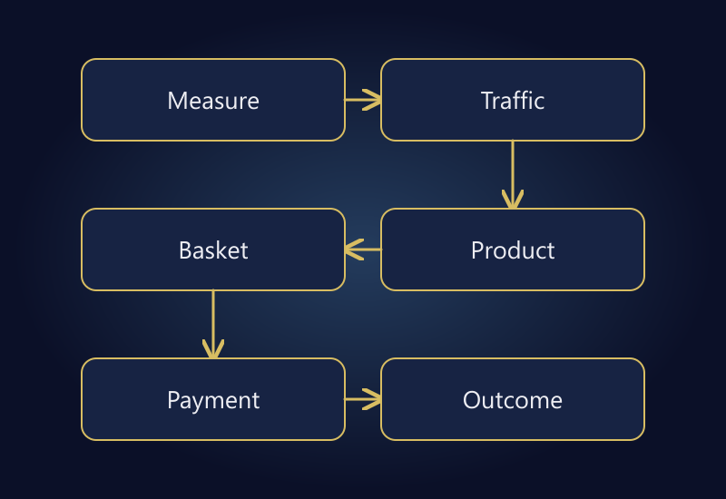

If your online store gets traffic but no sales, increasing the ad budget is rarely a sensible first move. Establish whether orders are genuinely missing, then identify where visitors stop. Poor traffic fit, an unclear product offer, delivery surprises, and payment failures can produce the same headline symptom while requiring different work.

The useful outcome of an audit is a specific finding: “New mobile visitors cannot select a size on these products.” That is actionable. “The website needs to be better” is not a diagnosis and provides little basis for deciding what to fix first.

The examples below are hypothetical. They are not client results, benchmark conversion rates, or promises of improvement. The method is designed to reduce wasted effort before you commit more money to traffic or a redesign.

*Diagnose the layer first: measurement, traffic, product, basket, payment, and outcome.*

## Separate a sales problem from a reporting problem

Compare paid orders in the store, successful transactions in the payment provider, and recorded purchases in Analytics for the same period. Those totals may differ. A payment that is missing from Analytics is a measurement issue until evidence shows otherwise; it does not mean that the customer could not buy.

[Google's ecommerce measurement documentation](https://developers.google.com/analytics/devguides/collection/ga4/ecommerce) treats purchases and refunds as distinct events. Keep that distinction in your operational review too. A created order is not necessarily a paid order, and a refunded sale is not retained revenue.

Start a small reconciliation sheet with order ID, time, amount, payment status, and cancellation or refund status. Do not copy unnecessary customer details into it. Check whether consent, event setup, or transaction identification explains the gap before investigating a payment failure that may not exist.

If your business accepts payment outside the online checkout, document that route separately. Otherwise you may judge the checkout against sales it was never intended to process. Agree on what counts as a completed online purchase before calculating any rate.

## Traffic is not the same as buying intent

A person researching a repair guide and a person searching for an exact replacement part are at different stages. A useful content library can attract visitors who are not ready to buy immediately. Including those visits in a store-wide conversion rate does not make the content worthless; it changes the interpretation of the denominator.

Review source, landing page, device, and returning status together. Begin with two or three commercially meaningful segments rather than splitting a small audience into dozens of tiny groups. A handful of sessions cannot support a confident conclusion about an entire channel.

Check the promise made before the visit. Does the landing page deliver the product, price, variant, and delivery terms implied by the ad? Sending a broad category ad to an unavailable variant creates friction that a better checkout cannot repair. Campaign and landing-page decisions belong in the same review, which is part of [advertising and campaign management](/en/advertising-campaign-management/).

## Build a funnel with consistent units

Suppose one product group receives 1,000 relevant sessions in a week. Of those sessions, 120 include an add-to-cart action, 60 begin checkout, and 18 include a purchase. This example deliberately uses session-level counts throughout. Mixing raw event totals and sessions would make the ratios misleading.

| Stage | Hypothetical sessions | Share of previous stage |
|---|---:|---:|
| Relevant visit | 1,000 | — |
| Added to cart | 120 | 12% |
| Began checkout | 60 | 50% |
| Purchased | 18 | 30% |

The overall session conversion rate is 1.8%. That number alone does not tell you which action to take. The example shows product interest and checkout starts, so the later checkout journey deserves inspection. It does not prove that a 30% checkout completion rate is universally poor; we do not know the category, audience, or collection method.

Compare periods only after checking changes in device mix, promotions, availability, and product mix. If mobile traffic has increased sharply, a lower overall rate may reflect that shift. Attributing every movement to the latest design change would be premature.

## Can a customer make a product decision?

A visitor should not need to contact support to discover essential dimensions, compatibility, pack contents, or usage restrictions. The right amount of detail depends on the product. Longer copy is useful only when it resolves a genuine buying question.

For a shelf, depth may matter more than a promotional paragraph. For a cable, the connector and supported standard may be decisive. For clothing, real measurements may be more useful than a generic size label. Make the uncertainty visible, then remove it with accurate information.

Do not manufacture reviews, urgency, or performance claims to fill a trust gap. Clear product photography, honest availability, and understandable terms create a more durable foundation. A polished badge cannot compensate for contradictory product information.

Select five high-traffic products with weak add-to-cart performance. Write down what a buyer must know before ordering each one. Turn repeated gaps into a category-specific content template, rather than making disconnected edits to individual pages.

## Reveal delivery costs and checkout conditions early

Unexpected shipping charges, unclear delivery timing, and forced account creation are useful audit hypotheses. [Baymard's checkout research](https://baymard.com/blog/reduce-cart-abandonment) discusses these forms of friction. It provides a research framework, not proof that the same issue is causing losses in your store.

If you promise dispatch on the same day, explain the relevant cutoff and location conditions. An attractive promise that operations cannot meet exchanges a conversion problem for a customer-service problem. Test the promise against how an actual order is fulfilled.

Follow a realistic basket through product selection, coupon entry, delivery calculation, and final payment. Check whether the amount changes without explanation. An expired promotion should produce a clear message; a valid discount should not disappear between the basket and payment screen.

When offering payment methods, inspect the complete experience rather than the logos in the footer. A method that is listed but unavailable for the customer's currency or location can create confusion. Make applicable restrictions understandable before the customer reaches a dead end.

## Test mobile as a new customer

Store owners often test while signed in, with a saved address and a strong connection. A first-time buyer has none of those advantages. Use a fresh session, enter a new address, and check more than one narrow screen width.

Look for a keyboard covering the continue button, a variant selector that closes unexpectedly, an error message outside the visible area, or a required field with no clear label. These are functional barriers, not cosmetic preferences. Record the device, browser, product, step, and time so another person can reproduce the issue.

Use the payment provider's sandbox when available. If a real transaction is required, keep it authorized and controlled. Do not expose payment or personal information in recordings. A repeatable test is more useful than an unqualified “It worked on my phone.”

## Let the evidence set the priority

| Observation | First check | Likely workstream |
|---|---|---|
| Paid orders exist, Analytics purchases do not | Consent, events, transaction IDs | Measurement |
| Product views without add-to-cart activity | Variants, availability, offer clarity | Product experience |
| Baskets without checkout starts | Shipping and total cost | Basket communication |
| Checkout starts without successful charges | Provider logs and error step | Payment reliability |
| Orders exist but contribution is weak | Costs and product mix | Pricing and channel economics |

This is a triage tool, not an automatic diagnosis. Several problems can coexist. Fixing a reproducible payment error usually deserves priority over testing a different headline color.

Write a short change log before starting. Include the hypothesis, affected products, implementation date, and measure of success. Avoid simultaneously changing the offer, targeting, and checkout layout if you intend to interpret the result as a single experiment.

## Run a focused first-week review

Use the first day to reconcile orders and measurement. Next, select the important traffic and device segments. Inspect product information and variants, then complete a mobile checkout test. Spend the remaining time addressing the clearest issue and monitoring the relevant step.

Low-traffic stores may need much longer than a week to evaluate a commercial effect. A functional repair can be verified immediately; its impact on conversion may remain uncertain. Do not increase spending aggressively because one day looks better.

Keep a decision log even when the finding is inconclusive. “No payment error reproduced; insufficient mobile checkout volume” is a useful outcome. It prevents the team from repeatedly investigating the same hypothesis without new evidence.

## Frequently asked questions

### Should I stop advertising if visitors are not buying?

If customers cannot complete payment or buy the advertised stock, limiting the affected traffic may be sensible. A low overall conversion rate alone is not enough to shut down every campaign. Identify the scope first.

### Is there a good conversion rate for every store?

No. Product price, buying frequency, audience, and measurement definitions differ. Compare consistent periods and relevant segments. Treat context-free averages as questions to investigate, not mandatory targets.

### Will a redesign solve the problem?

A platform replacement may be justified when core requirements cannot be met sustainably. It will not automatically repair an unsuitable offer or incorrect reporting. Diagnose the constraint before selecting the project.

### Should every abandoned basket trigger a message?

No. Applicable consent and communication rules matter, and not every abandoned basket represents a recoverable purchase. Fix avoidable friction first, then assess lawful and appropriate follow-up.

## Start with a finding you can act on

The first objective is not a longer task list. It is a clear explanation of where the buying journey breaks and what evidence supports that conclusion. Connect technical reliability, product information, and commercial terms before buying more visits.

For a structured review of that journey, explore [ecommerce website management](/en/ecommerce-website-management/) or [get in touch](/en/#iletisim) with your platform, the affected products, and the behavior you have observed.
