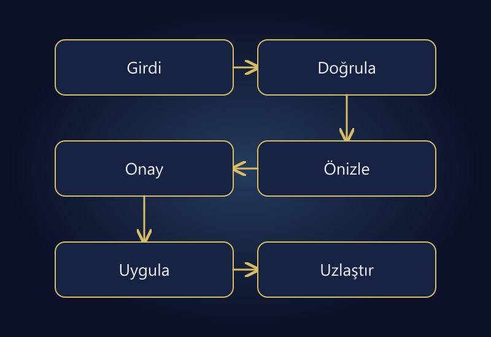

E-ticarette otomasyona en çok vakit alan işten değil, kuralları net ve hata durumunda kontrol edilebilir işten başlamak genellikle daha güvenlidir. Her tekrarlanan işlem kodlanmalı değildir; her kodlanabilen işlem de gözetimsiz çalıştırılmamalıdır. Excel, Python ve ERP farklı ihtiyaçlara hizmet eder.

İlk aday, aynı kaynaktan düzenli gelen bir raporun temizlenmesi olabilir. Buna karşılık canlı fiyat güncelleme, stok düzeltme veya sipariş iptali gibi işlemler daha güçlü kontroller gerektirir. Kazandırılacak dakika kadar yanlış bir işlemin ulaşabileceği ürün ve müşteri sayısı da değerlendirilmelidir.

Bu rehber yeni bir yazılım satın alma listesi değildir. Mevcut araçlarla nereden başlanacağını, hangi işte insan onayının kalması gerektiğini ve otomasyonun sürdürülebilirliğinin nasıl hesaplanacağını anlatır. Örnek süreler gerçek bir müşteri projesine ait değildir.

## Önce işi tarif edin, sonra aracı seçin

“Excel'i otomatikleştirelim” talebi hangi kararın verildiğini söylemez. Girdi nedir, hangi alanlar kullanılır, çıktı kime gider, kim onaylar ve yanlış sonuç nasıl fark edilir? Bu sorular yanıtlanmadan araç seçmek yalnızca mevcut belirsizliği başka bir yere taşır.

Bir iş kartı hazırlayın: kaynak dosya veya sistem, tetiklenme sıklığı, uygulanan kural, beklenen çıktı, istisnalar, sorumlu kişi ve geri dönüş yöntemi. Son üç uygulamadan örnek alın. Her seferinde çalışan tarafından farklı yorumlanan kural varsa önce süreci standartlaştırın.

Örneğin “satış raporunu düzenlemek” yerine “dünkü sipariş dosyasındaki iptalleri ayırmak, SKU'ları katalogla eşleştirmek ve bilinmeyen kodları istisna listesine yazmak” daha iyi tanımdır. Otomasyonun başarısı dosyanın oluşması değil, bu sözleşmenin doğru karşılanmasıdır.

## Aday işleri risk ve tekrar sıklığıyla sıralayın

| İş | İlk otomasyon yaklaşımı | Kritik kontrol |
|---|---|---|
| Düzenli rapor birleştirme | Salt okunur veri hazırlama | Kayıt ve tutar toplamları |
| Ürün bilgisi eksiklerini bulma | İstisna raporu | Yanlış eşleşmeleri ayırmak |
| Fiyat güncelleme | Önizleme ve onaylı toplu işlem | Değişim sınırı ve geri dönüş |
| Stok düzeltme | Merkez kayıtla kontrollü uzlaştırma | Rezervasyon ve kanal etkisi |
| Sipariş iptali | Yetkili onaylı iş akışı | Finansal ve müşteri etkisi |

Bu tablo “rapor güvenlidir, fiyat tehlikelidir” gibi mutlak bir sınıflandırma değildir. Rapor da hassas veri içerebilir. Fakat salt okunur bir çıktının yanlışlığını canlı bir fiyat değişikliğine göre daha kolay sınırlayabilirsiniz. İlk projede bu farkı kullanın.

Yüksek sıklıklı ama sürekli istisna üreten bir iş, düşük sıklıklı ve çok net bir işten daha zor olabilir. İşlem adedini tek başına öncelik puanı gibi kullanmayın. Kuralların açıklığı, hatanın etkisi ve bakım sorumluluğu birlikte değerlendirilmelidir.

## Excel nerede yeterli olabilir?

Az sayıda kontrollü dosya, sınırlı kullanıcı ve insan tarafından incelenen raporlar için Excel veya benzeri tablo araçları yeterli olabilir. Önce tutarlı sütun adları, veri türleri, doğrulamalar ve sürüm düzeni kurun. Gereksiz yere yeni uygulama geliştirmek bakım yükünü artırır.

Ancak “çalışan dosya” ile sürdürülebilir süreç aynı değildir. Formüllerin elle sürüklenmesi, gizli sütunlar, yanlış sayfaya yapıştırma ve kişiye bağlı dosya adları tekrarlanıyorsa kontrol ihtiyacı vardır. Dosyayı kim hazırlarsa hazırlasın aynı kurallarla çalışması hedeflenmelidir.

Tanımlayıcıları sayı gibi dönüştürmemeye dikkat edin. `00123` ürün kodunun `123` olması farklı kayıtlarla eşleşebilir. Tarih ve ondalık biçimleri de dışa aktarım kaynağına göre değişebilir. Dosya açılıyor olması verinin doğru yorumlandığını göstermez.

## Python ne zaman anlamlıdır?

Dosyalar sık geliyor, aynı dönüşümler tekrarlanıyor, kaynaklar birden fazla ve istisna raporu gerekiyorsa bir betik uygun olabilir. [Python'ın CSV belgesi](https://docs.python.org/3/library/csv.html), ayraç ve alıntılama gibi dosya farklılıklarını ele alan standart modülü açıklar. Bu, her dosyayı virgülle bölmenin güvenilir bir aktarım yöntemi olmadığına iyi bir örnektir.

Betik önce girdiyi doğrulamalıdır: beklenen sütunlar var mı, kodlar benzersiz mi, zorunlu alanlar boş mu, para birimi biliniyor mu? Beklenmeyen biçimde sessizce devam etmek yerine açık hata veya istisna listesi üretmelidir. Eksik alanı tahminle doldurmak özellikle fiyat ve stokta risklidir.

Python kullanmak işi kendiliğinden sürdürülebilir yapmaz. Çalıştırma ortamı, bağımlılık sürümleri, ayarlar, kayıtlar ve bakım sahibi tanımlanmalıdır. Bir kişinin bilgisayarında çalışan fakat başka yerde tekrarlanamayan araç, operasyonun yeni tek hata noktası olabilir.

## ERP entegrasyonu hangi problemi çözer?

ERP, sipariş, stok, ürün veya mali süreçlerin merkezi kaydı olabilir. Entegrasyonun görevi yalnızca dosyayı kaldırmak değildir; alan ve durumların anlamlarını sistemler arasında korumaktır. Aynı “iptal” durumu iki sistemde farklı aşamaları temsil edebilir.

Bir bağlantıdan önce veri eşleşmesi, yetkili kaynak, senkronizasyon yönü ve hata yönetimi tanımlansın. Önceki [stok senkronizasyonu rehberi](/blog/pazaryeri-e-ticaret-stok-senkronizasyonu/) bunun miktar ve rezervasyon tarafını ele alır. ERP var diye her alanın çift yönlü güncellenmesi gerektiğini varsaymayın.

Mevcut güvenilir bağlantı ihtiyacı karşılıyorsa sadece özel yazılım yapmak için yeniden geliştirmeyin. Eksik olan bir hata raporu veya alan eşleştirmesi olabilir. Önce gerçek darboğazı bulmak, araç değişiminden daha düşük riskli ve daha hızlı olabilir.

## Kazanılan süreyi bakım dahil hesaplayın

Varsayımsal bir iş haftada beş kez 25 dakika sürsün: toplam 125 dakika. Otomasyon sonrasında her çalışmanın incelemesi beş dakika, haftalık istisna çözümü 20 dakika ve bakım payı 15 dakika olsun. Yeni toplam 25 + 20 + 15 = 60 dakikadır; haftalık tasarruf 65 dakikadır.

| Kalem | Örnek süre |
|---|---:|
| Önceki haftalık iş | 125 dakika |
| Otomasyon sonrası kontrol | 25 dakika |
| İstisna çözümü | 20 dakika |
| Bakım payı | 15 dakika |
| Kalan haftalık tasarruf | **65 dakika** |

İlk geliştirme 10 saat sürdüyse yalnızca zaman hesabıyla geri kazanım yaklaşık 600 / 65 ≈ 9,2 haftadır. İstisna süresi haftada 40 dakikaya çıkarsa tasarruf 45 dakikaya, aynı hesapla geri kazanım yaklaşık 13,3 haftaya gider. Bunlar ücret veya finansal yatırım getirisi hesabı değildir; sabit iş yükü varsayan örneklerdir.

Hata azalması önemli bir fayda olabilir ama bunu ölçmeden para karşılığı uydurmayın. Otomasyon sonrası kaç düzeltme gerektiğini, istisna oranını ve toplam kapanış süresini kaydedin. “Butona basınca bir saniyede bitiyor” ifadesi inceleme ve bakım işini gizleyebilir.

*Canlı yazma işleminden önce doğrulama ve onayı, işlemden sonra uzlaştırmayı planlayın.*

## Güvenli akış: doğrula, önizle, uygula, uzlaştır

1. Girdiyi salt okunur olarak alın ve sürümünü kaydedin.
2. Alanları ve veri türlerini doğrulayın.
3. Değişecek kayıtları önizleme olarak üretin.
4. Eşleşmeyen veya sınır dışı değerleri ayırın.
5. Riskli işlem için yetkili onayı alın.
6. Sınırlı kapsamda uygulayın.
7. Hedef sistemden sonucu okuyup karşılaştırın.
8. Hata, tekrar deneme ve geri dönüş kaydını saklayın.

Aynı dosyanın ikinci kez işlenmesi çift sipariş veya çift stok hareketi yaratmamalıdır. Hedef sistemin sunduğu işlem kimliği ve tekrar güvenliği olanaklarını inceleyin. Destek yoksa “bir kez çalışır” varsayımıyla canlı yazma yapmayın; ek kontrol tasarlayın.

Kısmi başarıyı da planlayın. 100 kayıttan 70'i işlendiğinde kalan 30'u tekrar denemekle bütün dosyayı yeniden göndermek aynı şey değildir. Hangi kayıtların tamamlandığı izlenmeli; geri dönüşün de her dış sistemde otomatik ve kusursuz olacağı varsayılmamalıdır.

## Dosya ve erişim güvenliğini atlamayın

Erişim anahtarlarını kaynak dosyaya, herkese açık depoya veya hata günlüğüne yazmayın. İhtiyaç duyulmayan kişisel veriyi işlem hattına taşımayın. Okuma yetkisi yeterliyse yazma yetkisi vermek gereksiz etki alanı oluşturur.

[OWASP'ın CSV Injection açıklaması](https://community.owasp.org/attacks/CSV_Injection), güvenilmeyen girdinin tablo programlarında formül gibi yorumlanabileceğine dikkat çeker. Dış veriyi rapora koyarken hedef programın davranışını dikkate alın. Genel veri temizliği yapıyorum diyerek ürün kodlarını bozmakla, tehlikeli girdiyi güvenli göstermek aynı işlem değildir.

Girdi dosyalarını çalıştırılabilir talimat gibi değerlendirmeyin. E-postayla gelen dosyanın makro çalıştırması veya bir rapor alanının sistem komutuna dönüştürülmesi gerekmemelidir. Özellikle otomasyonun “kolaylaştırdığı” adımların yetki sınırını koruyun.

## İlk pilotun başarı ölçütlerini yazın

Pilot için tek iş, tek veri kaynağı ve sınırlı bir dönem seçin. Başlangıç ve hedef çıktılarını karşılaştırın. Eksik sütun, boş değer, mükerrer kod, farklı tarih biçimi, bağlantı kesintisi ve ikinci çalıştırma senaryolarını test edin.

Başarılı test, sadece normal dosyanın işlenmesi değildir. Hatalı dosyada işlem güvenli şekilde duruyor veya yanlış kayıtlar açıkça ayrılıyor mu? Sonuçlar [KPI ve raporlama rehberindeki](/blog/e-ticaret-kpi-yonetim-paneli/) gibi tanımlı ölçütlerle izlenebiliyor mu? Bunlar tamamlanmadan gözetimsiz çalışmayı açmayın.

## Sık sorulan sorular

### İlk iş olarak bütün operasyonu otomatikleştirmeli miyim?

Hayır. Net kurallı ve düşük etkili bir pilot daha güvenli öğrenme sağlar. Birden fazla kritik sistemi aynı anda değiştirmek hata kaynağını ve geri dönüşü zorlaştırır.

### Excel kullanmak amatörlük müdür?

Hayır. Kontrollü, belgelenmiş ve ihtiyaca uygun bir tablo değerli olabilir. Sorun aracın adı değil; doğrulama, sahiplik, tekrar edilebilirlik ve hata yönetiminin olmamasıdır.

### Python betiği yazıldıktan sonra bakım biter mi?

Hayır. Kaynak sütunları, platformlar, erişimler ve iş kuralları değişebilir. Bakım sorumluluğu ve sürüm yönetimi baştan planlanmalıdır.

### Otomatik işlem hatalı sonuç verirse geri alınabilir mi?

Her işlem için garanti edilemez. Önceki değerler, işlem kayıtları ve hedef sistemin yetenekleri önemlidir. Riskli değişikliklerde önizleme, onay ve sınırlı uygulama bu nedenle gereklidir.

## Önce kontrollü bir işi güvenilir hale getirin

Başarılı otomasyon, görünmez çalışan kod değil; ne yaptığı, ne zaman durduğu ve hatada kimin devraldığı belli olan süreçtir. Süre tasarrufunu doğruluk ve bakım yüküyle birlikte değerlendirin. En iyi ilk proje çoğu zaman en gösterişli olan değil, işletmenin güvenle tekrar edebildiği olandır.

İlk pilotu seçmek veya mevcut dosya akışını incelemek için [operasyon otomasyonu](/operasyon-otomasyon/) ve [ERP entegrasyonu](/erp-entegrasyonu/) hizmetlerini değerlendirebilir; örnek iş adımlarını [iletişim bölümünden](/#iletisim) paylaşabilirsiniz. Hassas dosya veya erişim bilgisi göndermeden önce güvenli paylaşım yöntemini netleştirin.
