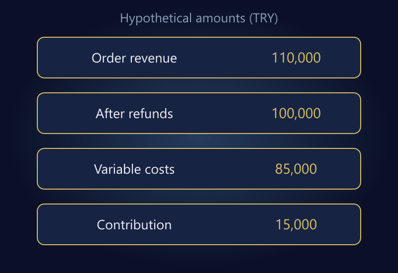

A useful ecommerce dashboard does not display the largest possible number of KPIs. It makes decisions clearer: what a metric includes, who owns it, and when action is required. Revenue growth can coexist with weaker contribution, and an attractive advertising report can conceal a growing returns burden.

Start with sales, acquisition, contribution, returns, delivery, and inventory. Give each metric a definition, source, owner, and refresh schedule. If the report ends without answering “What should we do next?”, adding more charts is unlikely to help.

The dashboard and figures below are hypothetical. They are not industry benchmarks or a customer performance report. Their purpose is to show how consistent scope changes the interpretation of familiar numbers.

## Write a metric dictionary first

Revenue, orders, customers, and conversion are incomplete labels. Does revenue include tax and delivery? Are canceled orders counted? How are guest purchases identified? Does conversion use sessions or users as its denominator?

[Google Analytics' explanation of ecommerce metrics](https://support.google.com/analytics/answer/13428834?hl=en) distinguishes transactions, purchases, and item quantities. Do not join similarly named fields from different systems without reading their definitions.

For each KPI, record the formula, included records, exclusions, time zone, source, and responsible person. Note whether a period can change after close. A late refund may alter a prior order cohort's result without indicating a calculation error.

Use stable definitions before discussing targets. Two teams can report different average order values while each has calculated its own definition correctly. The problem is not necessarily arithmetic; it may be an undocumented disagreement about revenue and order scope.

## Read an example on a consistent basis

Suppose a period contains 6,000 relevant sessions, 120 purchasing sessions, and 120 paid orders. Item revenue before discounts is TRY 120,000, discounts are TRY 10,000, and refunds attributable to the same order cohort total TRY 10,000. Tax and shipping revenue are outside this example.

| Metric | Calculation | Hypothetical result |
|---|---|---:|
| Session conversion | 120 / 6,000 | 2% |
| Order revenue after discounts | 120,000 − 10,000 | TRY 110,000 |
| Average order value at purchase | 110,000 / 120 | TRY 916.67 |
| Retained item revenue after refunds | 110,000 − 10,000 | TRY 100,000 |
| Retained revenue per original order | 100,000 / 120 | TRY 833.33 |

The last two averages answer different questions. Do not give both the same “average basket” label. One describes order value at purchase, while the other reflects revenue retained from the original cohort after refunds.

Purchasing sessions and orders happen to be equal here. In a real dataset, one session might contain multiple orders. Keep those units distinct rather than carrying the convenient equality into your reporting model.

Make definitions easy to find without crowding every card with footnotes. A compact dictionary or linked explanation works well. Attractive visual design cannot compensate for incompatible definitions behind the numbers.

*The example bridges order revenue and contribution; scope and calculations are explained below.*

## Add contribution to the revenue view

Assume retained revenue is TRY 100,000, retained cost of goods sold is TRY 50,000, other variable selling and operating costs are TRY 15,000, and media spend is TRY 20,000. Return-handling effects are included consistently in the relevant cost lines, not deducted twice.

**100,000 − 50,000 − 15,000 − 20,000 = TRY 15,000 contribution.**

This is before fixed overhead and tax, so it must not be labeled net profit. If a previous period produced more contribution from lower revenue, investigate product mix, discounting, and costs instead of assuming growth was commercially beneficial.

An advertising platform's attributed revenue may not match retained revenue for the same order cohort. In this example, retained item revenue divided by media spend equals five. That explicitly defined ratio is not being relabeled as platform ROAS.

Keep gross and retained views available when they support different decisions. Merchandising may need to see initial demand; finance may need the later retained outcome. The report should explain the bridge between them, not force one number to serve every purpose.

## Evaluate acquisition beyond a cheap order

Define the denominator of CPA: an attributed platform purchase or a verified paid order? If you calculate new-customer acquisition cost, document how a new customer is identified. Counting repeat purchases as new customers makes acquisition look artificially efficient.

Do not publish a precise lifetime-value figure when customer identities are fragmented or the observation window is inadequate. Expected future value and realized contribution are different forms of evidence. Combining them in one unqualified card can encourage excessive spending.

Include organic, direct, and other channels alongside paid media. Attribution systems can claim overlapping orders, so adding platform-reported revenue does not necessarily reproduce company revenue. The objective is to understand the overall economics, not let each channel justify itself independently.

## Track returns as both orders and money

Suppose eight of the 120 original orders include a refund. The order-based refund incidence is approximately 6.67%. Refunded value as a share of discounted revenue is 10,000 / 110,000, approximately 9.09%. Neither percentage replaces the other.

A refund processed this month may relate to a sale last month. Cohort analysis and period cash movements therefore answer different questions. Both can be useful, but the date basis and labels must be explicit.

[Google's ecommerce event guide](https://developers.google.com/analytics/devguides/collection/ga4/ecommerce) describes associating refunds with the relevant transaction. Analytics events still need reconciliation with order and payment records for financial use. Sending a refund event does not itself repair warehouse or accounting records.

Break out reasons only when the classifications are meaningful and consistently recorded. “Customer request” may be too broad to guide product improvements. Avoid demanding unnecessary personal information merely to create a more detailed chart.

## Keep operations and inventory in view

If 92 of 100 orders due for delivery met the defined promise, on-time delivery is 92%. Do not include 20 orders whose delivery deadline has not arrived in the denominator. Define “on time” using the promise actually made to customers.

Inventory reporting should distinguish total stock, available stock, unavailable units, and material discrepancies. Advertising an unavailable item may be a stock-process problem that first appears in campaign results. The [inventory synchronization guide](/en/blog/marketplace-store-inventory-sync/) explains the relevant state distinctions.

For a hypothetical 30-day period with cost of goods sold of TRY 50,000 and average inventory cost of TRY 25,000, period turnover is two and the simple stock-duration calculation is 15 days. This describes the past period. It does not guarantee the same sales velocity next month.

## Separate daily operations from monthly management

Daily monitoring may prioritize payment failures, stalled integrations, critical stock differences, and overdue orders. Monthly management needs product contribution, channel economics, returns patterns, and inventory efficiency.

| Metric group | Example review cadence | Decision supported |
|---|---|---|
| Payment and transfer errors | Daily as operations require | Contain and repair failures |
| Critical inventory differences | Based on sales velocity | Correct allocation or reservations |
| Product contribution | Weekly or monthly close | Adjust pricing and product mix |
| Return reasons | After sufficient observations | Improve information or operations |
| Channel and customer economics | Consistent comparison periods | Allocate budget and growth effort |

These cadences are examples, not universal service levels. Adapt them to the business and the source delay. A dashboard that hides its refresh time can present yesterday's data as a live operational picture.

Give each meaningful threshold an owner and first action. A red card without a response process is decoration. Too many false alarms train the team to ignore the report, including the warnings that matter.

## Preserve changes to metric definitions

If a revised formula excludes canceled orders, the new result may not be directly comparable with the old series. Keep the definition version and effective date. Recalculate history when appropriate, or clearly mark the break.

Review dashboard usage as well as its contents. A metric that never changes a decision may belong in a supporting report rather than the main screen. The aim is a smaller, trustworthy decision surface, not a permanent collection of every requested chart.

## Frequently asked questions

### How many KPIs should the first dashboard contain?

There is no required number. Choose a limited set that supports decisions across sales, contribution, returns, delivery, and stock. A metric without a clear definition or owner is not ready for the main view.

### Should I trust Analytics or the store admin?

Their scopes differ. Use appropriate order and payment records for operational and financial reconciliation, and suitable measurement tools for traffic and behavior. Understand the differences before choosing a source for a particular question.

### Does higher revenue mean better performance?

Not on its own. Discounts, product cost, media spend, returns, and operating costs change the result. Read revenue alongside contribution and cash effects.

### Do I need a new dashboard platform?

Not necessarily. A controlled spreadsheet with a sound metric dictionary can be a sensible starting point. Define decisions and data requirements before selecting a tool.

## Make reporting a shared decision system

A good dashboard helps the team attach the same meaning to the same number. Definitions, sources, ownership, and actions make reports useful together instead of allowing them to compete for authority.

To bring order, advertising, and operational data into a consistent framework, explore [data analysis and reporting](/en/data-analysis-reporting/) or [get in touch](/en/#iletisim) with the decisions your current reports cannot support.
