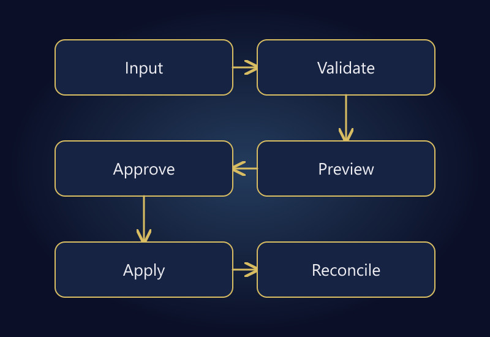

The best first ecommerce automation is often not the task consuming the most time. It is a task with clear rules, observable results, and a manageable failure mode. Repetition alone does not justify code, and the ability to automate an action does not mean it should run without supervision.

Cleaning a recurring report can be a sensible starting point. Updating live prices, correcting inventory, or canceling orders requires stronger controls. Evaluate both the minutes saved and the number of products or customers a mistake could affect.

This is not a software shopping list. It explains how to choose between spreadsheets, Python, and ERP integration, where human approval belongs, and how to assess ongoing maintenance. The time examples are hypothetical, not project results or savings promises.

## Define the process before choosing the tool

“Automate our spreadsheet” does not identify the decision being made. What is the input? Which fields are used? Who receives the output? Who approves a change, and how would an incorrect result be detected? Choosing software before answering those questions moves uncertainty rather than resolving it.

Create a task card covering source, frequency, rules, expected output, exceptions, owner, and recovery method. Review examples from the last few runs. If people apply different interpretations each time, standardize the rule before automating it.

“Prepare the sales report” is vague. “Separate cancellations from yesterday's orders, match SKUs to the catalog, and place unknown codes in an exception report” is testable. Success means meeting that contract, not merely producing a file.

## Prioritize by clarity, repetition, and impact

| Task | Initial approach | Critical control |
|---|---|---|
| Recurring report preparation | Read-only transformation | Record and amount totals |
| Missing product information | Exception reporting | Avoid incorrect matches |
| Price updates | Preview and approved batch | Change limits and recovery |
| Inventory corrections | Controlled reconciliation | Reservations and channel effects |
| Order cancellation | Authorized workflow | Customer and financial impact |

This is not an absolute safe/unsafe classification. Reports can contain sensitive information too. However, an incorrect read-only output is often easier to contain than a live price change. That distinction is valuable when choosing a first pilot.

A high-volume task with constant exceptions may be harder to automate than a less frequent, well-defined task. Transaction count alone is not a priority score. Consider rule clarity, failure impact, and who will maintain the process.

## When a spreadsheet may be sufficient

A small number of controlled files, limited users, and human-reviewed outputs may not require a new application. Begin with consistent columns, data types, validation, and version management. Building custom software without a clear need creates another maintenance obligation.

A working workbook is not automatically a sustainable process. Manually extending formulas, hidden columns, pasting into the wrong sheet, and person-dependent filenames are warning signs. The objective is for the same rules to hold regardless of who prepares the file.

Treat identifiers carefully. Turning product code `00123` into numeric value `123` can create an incorrect match. Dates and decimal separators also vary between sources. A file opening successfully does not prove its values were interpreted correctly.

Document the handoff. Where is the approved version stored? Which inputs produced it? Who has permission to edit the formulas? These small controls can improve reliability without changing the tool at all.

## When Python becomes useful

A script can make sense when files arrive frequently, transformations repeat, several sources must be combined, and exceptions need explicit reporting. [Python's CSV documentation](https://docs.python.org/3/library/csv.html) describes standard handling for delimiters and quoting. It illustrates why splitting every line on a comma is not a reliable import strategy.

Validate inputs before transforming them. Are required columns present? Are identifiers unique? Are mandatory values missing? Is the currency known? Unexpected input should produce a clear failure or exception list, not a plausible-looking guessed result.

Python does not make the operation self-maintaining. Define the runtime, dependency versions, settings, logs, and owner. A script that runs only on one person's computer may become a new single point of operational failure.

Keep business rules separate from secrets and machine-specific paths. A future maintainer should be able to identify the rule being applied without copying credentials or reconstructing undocumented desktop arrangements.

## What ERP integration should achieve

An ERP may be the central record for orders, inventory, products, or financial processes. Integration is not just the removal of a file transfer. It must preserve the meaning of fields and states between systems. “Canceled” may refer to different stages in two applications.

Define mappings, authoritative sources, update direction, and failure handling before connecting systems. The [inventory synchronization guide](/en/blog/marketplace-store-inventory-sync/) covers quantity and reservation implications. An ERP's presence does not mean every field should be synchronized in both directions.

Do not rebuild a reliable existing connection simply to own a custom application. The missing capability may be an exception report or a corrected mapping. Investigate the actual constraint before proposing a platform replacement.

## Count review and maintenance in the savings

Suppose a manual task takes 25 minutes and runs five times a week: 125 minutes in total. After automation, each run needs five minutes of review, weekly exceptions take 20 minutes, and maintenance is allocated 15 minutes. The new total is 25 + 20 + 15 = 60 minutes, leaving 65 minutes saved per week.

| Item | Hypothetical time |
|---|---:|
| Previous weekly work | 125 minutes |
| Review after automation | 25 minutes |
| Exception handling | 20 minutes |
| Maintenance allocation | 15 minutes |
| Remaining weekly saving | **65 minutes** |

If initial development took ten hours, the simple time-recovery calculation is 600 / 65, approximately 9.2 weeks. If exceptions rise to 40 minutes weekly, the saving becomes 45 minutes and the same calculation extends to approximately 13.3 weeks.

These are not financial ROI calculations. They assume a stable workload and do not price labor or other benefits. Fewer mistakes can be valuable, but do not invent a monetary value before measuring their frequency and impact.

Track total completion time, required corrections, and exception rates after launch. “The button finishes in one second” can conceal substantial review and repair work elsewhere in the process.

*Plan validation and approval before live writes, then reconcile the result afterward.*

## Use a controlled processing sequence

1. Read the source and record its version.
2. Validate fields and data types.
3. Produce a preview of proposed changes.
4. Separate unmatched or out-of-range records.
5. Obtain authorized approval for consequential actions.
6. Apply changes within a limited scope.
7. Read results back from the target and reconcile them.
8. Retain failure, retry, and recovery records.

Processing the same file twice should not create duplicate orders or stock movements. Examine the target's operation identifiers and replay-safety capabilities. If those controls are absent, do not assume a job will run exactly once; design additional safeguards before enabling live writes.

Plan partial success too. If 70 of 100 records succeed, retrying the remaining 30 differs from sending all 100 again. Track completed records and do not promise that every external side effect can be reversed automatically.

## Protect access and exported data

Do not place access keys in source files, public repositories, or logs. Avoid moving personal data through the pipeline when the task does not require it. Read-only access should remain read-only where it is sufficient.

[OWASP's CSV Injection guidance](https://community.owasp.org/attacks/CSV_Injection) highlights the risk of untrusted values being interpreted as spreadsheet formulas. Consider the receiving application's behavior when exporting external data. Preserving product identifiers and making unsafe input harmless are different validation problems.

Do not treat an input file as executable instructions. A report import should not require enabling arbitrary macros, and a cell value should not become an operating-system command. Convenience is not a reason to expand an automation's authority unnecessarily.

Make logs useful without making them a secondary database of customer information. Record the record key, processing stage, and error category where possible. Define retention and access for the operational evidence you keep.

## Set acceptance criteria for a small pilot

Choose one task, one source, and a limited observation period. Compare the approved baseline output with the automated result. Test missing columns, empty fields, duplicate codes, unexpected dates, connection failure, and a repeated run.

A normal input succeeding is only one scenario. Does malformed data stop safely or enter an explicit exception queue? Can the outcome be monitored with definitions like those in the [ecommerce KPI guide](/en/blog/ecommerce-kpi-management-dashboard/)? Keep unattended operation disabled until these controls are understood.

Write a handover note covering how to run the job, recognize failure, suspend it, and recover or escalate. The person responsible for operations should not have to read the source code to know whether the job completed safely.

## Frequently asked questions

### Should the whole operation be automated first?

No. A limited, well-defined pilot provides safer learning. Changing several critical systems simultaneously makes causes and recovery harder to isolate.

### Is using Excel unprofessional?

No. A controlled, documented spreadsheet can be appropriate. The real issues are validation, ownership, repeatability, and error handling, not the tool's name.

### Does maintenance end once a Python script works?

No. Sources, platforms, access, and business rules change. Ownership and version management should be part of the initial plan.

### Can an incorrect automated action always be undone?

No. Recovery depends on prior values, operation records, and the target system. That is why consequential changes need previews, approvals, and limited rollout.

## Make one process dependable before expanding

Good automation is a process whose actions, stopping conditions, and human handoff are understood. Evaluate time savings alongside correctness and ongoing maintenance. The best first project is often the one the business can repeat confidently, rather than the most impressive demonstration.

To select a pilot or review an existing file workflow, explore [operations automation](/en/operations-automation/) and [ERP integration](/en/erp-integration/), or [get in touch](/en/#iletisim) with the task steps. Agree on a secure sharing method before sending sensitive files or access details.
