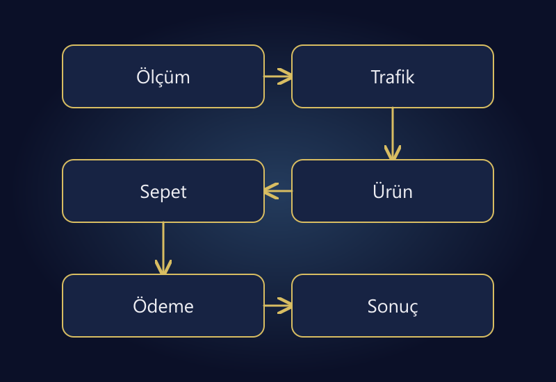

E-ticaret sitenize ziyaretçi geliyor ama satış olmuyorsa ilk iş reklam bütçesini artırmak veya siteyi yeniden tasarlamak değildir. Önce gerçekten sipariş gelmediğini, ardından ziyaretçinin satın alma yolculuğunda nerede durduğunu doğrulayın. Trafik kalitesi, ürün teklifi, teslimat koşulları ve ödeme sorunları aynı belirtiyi oluşturabilir; çözümleri farklıdır.

Bu rehberin önerisi, sorunu tek bir dönüşüm oranına sıkıştırmak yerine kanıtlarla daraltmaktır. “Mobil ziyaretçiler belirli bir ürünün bedenini seçemiyor” bulgusu düzeltilebilir. “Site yeterince iyi değil” değerlendirmesi ise hangi işe başlanacağını söylemez.

Aşağıdaki rakamlar bir müşteriye ait sonuçlar değil, teşhis yöntemini anlatmak için hazırlanmış varsayımsal örneklerdir. Amaç garanti satış formülü vermek değil; yanlış sorunu çözerek zaman ve bütçe kaybetmenizi önlemektir.

*Ölçümden sonuca uzanan teşhis sırası; önce sorunun hangi katmanda olduğunu belirleyin.*

## Önce satış ile ölçümü birbirinden ayırın

Mağaza yönetim panelindeki ödenmiş siparişleri, ödeme sağlayıcısının işlem kayıtlarını ve Analytics raporunu aynı dönem için karşılaştırın. Üç sayı farklı olabilir. Ödeme alınmış bir siparişin Analytics'te görünmemesi, müşterinin satın alamadığı anlamına gelmez. Çerez izni, eksik olay kurulumu veya yanlış işlem kimliği ölçüm farkına neden olabilir.

[Google'ın e-ticaret ölçüm belgesi](https://developers.google.com/analytics/devguides/collection/ga4/ecommerce), satın alma ve iade olaylarını ayrı ele alır. Bu ayrımı operasyon kayıtlarında da koruyun. Oluşturulmuş ama ödenmemiş sipariş, başarılı tahsilatla eş anlamlı değildir; iade edilmiş sipariş de korunmuş gelir gibi değerlendirilmemelidir.

Basit bir kontrol dosyası hazırlayın: sipariş numarası, sipariş zamanı, ödeme durumu, tutar, iptal ve iade durumu. Kişisel verileri gereksiz yere bu dosyaya taşımayın. Panelde sipariş varsa fakat raporda yoksa önce ölçümü düzeltin; olmayan bir ödeme arızasını aramayın.

## Ziyaret sayısı tek başına talebi göstermez

Bir rehber okumak için gelen kişi ile belirli bir ürünün fiyatını arayan kişi aynı niyette değildir. Blog trafiği yüksek bir mağazada toplam dönüşüm oranı, ürün aramasından gelen ziyaretçilere kıyasla düşük görünebilir. Bu durum blogun değersiz olduğunu veya tüm trafiğin kalitesiz olduğunu kanıtlamaz.

Kaynak, açılış sayfası, cihaz ve yeni/geri dönen ziyaretçi ayrımlarını birlikte inceleyin. Her kombinasyon için ayrı bir rapor üretmek yerine önce iş açısından anlamlı iki veya üç segment seçin. Küçük örneklemleri parçalayarak birkaç ziyaretten güçlü sonuç çıkarmayın.

Reklam metninde vaat edilen ürün, fiyat ve teslimat sayfada karşılanıyor mu? Genel bir kategori reklamının doğrudan tek varyantlı, stok sorunu olan ürüne gitmesi uyumsuzluk yaratabilir. Reklam ve mağaza birlikte değerlendirilmelidir; bu ilişkiyi [reklam kampanya yönetimi](/reklam-kampanya-yonetimi/) kapsamında ele almak daha sağlıklıdır.

## Satın alma akışını adımlara bölün

Örnek bir haftada aynı ürün grubuna ait 1.000 uygun oturum, 120 sepete ekleyen oturum, 60 ödeme adımına geçen oturum ve 18 satın alan oturum bulunduğunu varsayalım. Burada her sütun oturum düzeyindedir; ham olay sayılarıyla oturumları karıştırmıyoruz.

| Adım | Örnek sayı | Önceki adıma göre oran |
|---|---:|---:|
| Uygun oturum | 1.000 | — |
| Sepete ekleyen oturum | 120 | %12 |
| Ödemeye başlayan oturum | 60 | %50 |
| Satın alan oturum | 18 | %30 |

Toplam oturum dönüşümü %1,8'dir. Fakat bu tek sayı size neyi düzeltmeniz gerektiğini söylemez. Ürün ilgisi var, ödeme başlangıcı var; bu örnekte ilk inceleme alanlarından biri ödeme sonrası yolculuktur. Yine de %30 oranının sektör için “kötü” olduğunu sadece bu tablodan ilan edemeyiz. Ürün, trafik ve veri kapsamı bilinmiyor.

Önceki dönemle karşılaştırırken kampanya, ürün karması, stok ve cihaz dağılımı değişmiş mi bakın. Aynı hafta içinde mobil trafik payı artmışsa toplam oran düşebilir; bunu otomatik olarak yeni tasarıma bağlamak yanlış olur.

## Ürün sayfasında karar vermek mümkün mü?

Ziyaretçi ürünü anlamadan sepete eklemesini beklemeyin. Teknik özellik, ölçü, uyumluluk, paket içeriği ve kullanım koşulları ürünün gerektirdiği ayrıntıyla anlatılmalıdır. Her ürüne uzun metin eklemek çözüm değildir; satın alma kararındaki belirsizliği kaldırmak çözümdür.

Bir rafın derinliği, bir kablonun bağlantı standardı veya bir giysinin gerçek beden ölçüsü görünmüyorsa ziyaretçi soruyu başka yerde çözmeye çalışır. Güven oluşturmak için sahte yorum, stok baskısı veya doğrulanmamış başarı iddiası eklemeyin. Kendi çektiğiniz doğru görsel ve açık ürün bilgisi daha sürdürülebilirdir.

En çok ziyaret alan fakat sepete eklenmeyen beş ürün seçin. Her birinde şu soruyu sorun: “Bu ürünü görmeden satın alacak kişi neyi bilmek zorunda?” Eksik cevabı ürün grubuna uygun bir şablona dönüştürün. Böylece tek sayfayı yamamak yerine tekrarlayan içerik sorunu çözülür.

## Kargo ve ödeme koşullarını sona saklamayın

Sepette beklenmeyen kargo bedeli, teslimat belirsizliği veya zorunlu hesap oluşturma akışı incelenmesi gereken alanlardır. [Baymard'ın ödeme deneyimi araştırmaları](https://baymard.com/blog/reduce-cart-abandonment), alışveriş akışındaki sürtünmenin farklı türlerini ele alır. Bunları kendi mağazanızın ölçülmüş sorunu yerine kullanmayın; araştırma size test edilecek hipotez verir.

Ürün sayfasında teslimat vaadi varsa bunun hangi bölge ve sipariş saati için geçerli olduğu anlaşılmalıdır. Her ürüne aynı gün kargo yazıp operasyonun bunu karşılayamaması dönüşüm sorunu çözerken müşteri hizmetleri sorunu yaratır.

Kupon alanı da kontrol edilmelidir. Süresi bitmiş kodun anlaşılmaz hata vermesi veya indirimli fiyatın ödeme ekranında kaybolması müşteriyi durdurabilir. Gerçekçi bir test sepetiyle ürün fiyatını, kuponu, kargoyu ve ödenecek toplamı adım adım karşılaştırın.

## Mobil testi kendi alışkanlıklarınıza göre yapmayın

Mağaza sahibi olarak oturumunuz açık, adresiniz kayıtlı ve internetiniz hızlı olabilir. Yeni müşterinin koşulları farklıdır. Çıkış yapılmış bir oturumda, farklı ekran genişliklerinde, adresi ilk kez yazarak ve gerçekçi bir sepetle test yapın.

Varyant seçicinin kapanması, klavyenin devam butonunu örtmesi, zorunlu alan etiketinin görünmemesi veya hata mesajının ekranın üstünde kalması küçük tasarım ayrıntıları değildir. Bunlar sipariş yolunu kesen işlevsel sorunlar olabilir. Ekran kaydı alırken ödeme ve kişisel bilgileri paylaşmayın.

Ödeme sağlayıcısının test ortamı varsa önce onu kullanın. Gerçek işlem gerekiyorsa yetkili kişiyle sınırlı ve kontrollü çalışın. Bir hata gördüğünüzde cihaz, tarayıcı, ürün, adım ve zamanı kaydedin. “Bende çalıştı” yanıtının yerine tekrar edilebilir bir hata tarifi bırakın.

## Ne bulduğunuza göre iş sırasını değiştirin

| Gözlem | İlk kontrol | Öncelikli iş |
|---|---|---|
| Panelde ödeme var, Analytics'te yok | İzin, olay ve işlem kimliği | Ölçümü doğrulamak |
| Ürün görülüyor, sepete eklenmiyor | Varyant, stok, teklif ve bilgi | Ürün kararını kolaylaştırmak |
| Sepet var, ödeme başlangıcı az | Kargo ve toplam tutar | Beklenmeyen maliyeti açıklamak |
| Ödeme başlıyor, tahsilat başarısız | Sağlayıcı kayıtları ve hata adımı | Teknik ödeme sorununu çözmek |
| Satış var, katkı düşük | Giderler ve ürün karması | Fiyat ve kanal ekonomisini incelemek |

Bu matris kesin teşhis değildir. İlk denetim sırasını düzenler. Aynı mağazada birden fazla sorun bulunabilir; ödeme arızası varken başlık rengini test etmek kaynakları yanlış yere harcamaktır.

## Bir haftalık kontrollü iyileştirme planı

İlk gün sipariş ve ölçüm tutarlılığını kontrol edin. İkinci gün kaynak ve cihaz segmentlerini seçin. Üçüncü gün en önemli ürünlerin bilgi ve varyant akışını inceleyin. Dördüncü gün mobil sepet/ödeme testini tamamlayın. Kalan sürede en somut sorunu düzeltip sonucu izleyin.

Birden fazla büyük değişikliği aynı anda yaparsanız sonucun kaynağını ayıramazsınız. Hata düzeltmelerini gereksiz yere bekletmeyin; fakat yeni teklif, yeni reklam kitlesi ve yeni ödeme tasarımını tek deney gibi sunmayın. Başlangıç tarihi, değişiklik kapsamı ve değerlendirme ölçütünü yazın.

Az trafik bulunan mağazada bir haftanın istatistiksel karar için yetmeyebileceğini kabul edin. İşlevsel hatanın giderildiği doğrudan test edilebilir; ticari etkinin ölçülmesi daha uzun sürebilir. Daha iyi görünen ilk güne bakıp bütçeyi aniden büyütmeyin.

## Sık sorulan sorular

### Ziyaretçi var ama satış yoksa reklamı durdurmalı mıyım?

Ödeme veya stok hatası nedeniyle satın almak mümkün değilse ilgili trafiği sınırlandırmak gerekebilir. Ancak tek başına düşük dönüşüm oranı bütün reklamları kapatma kararı için yeterli değildir. Önce sorunun hangi ürün ve akışta olduğunu bulun.

### Her mağaza için iyi dönüşüm oranı aynı mı?

Hayır. Ürün fiyatı, satın alma sıklığı, trafik kaynağı ve ölçüm tanımı farklıdır. Kendi tutarlı geçmişinizle ve anlamlı segmentlerle karşılaştırma yapın; bağlamı belirsiz internet ortalamasını hedef diye almayın.

### Siteyi tamamen yenilemek çözüm olur mu?

Mevcut altyapı temel gereksinimleri karşılayamıyorsa yenileme değerlendirilebilir. Fakat yanlış ürün teklifi veya bozuk ölçüm, yeni temayla kendiliğinden çözülmez. Yeniden tasarımı teşhisin yerine koymayın.

### Sepeti terk eden herkese mesaj göndermeli miyim?

Hayır. Uygulanabilir izin ve iletişim kurallarına uyulmalıdır. Ayrıca her terk ediş teknik sorun değildir; kişi henüz karar vermiyor olabilir. Önce akıştaki sorunları düzeltin, sonra hukuka ve tercihlere uygun iletişimi değerlendirin.

## Önce düzeltilebilir bir bulgu elde edin

Satış sorununu çözmenin başlangıcı daha fazla iş yapmak değil, doğru işi seçmektir. Sipariş, trafik ve ekran davranışını aynı çerçevede inceleyin. Reklam verimliliğini değerlendirirken yalnızca satış sayısını değil, mevcut [ROAS ve kârlılık rehberindeki](/blog/roas-nedir-karli-mi/) katkı mantığını da kullanın.

Ürün sayfasından ödemeye kadar öncelikli kontrol alanlarını belirlemek için [e-ticaret sitesi yönetimi](/e-ticaret-sitesi-yonetimi/) hizmetini inceleyebilir veya [iletişim bölümünden](/#iletisim) mağazanızın altyapısını ve gözlemlediğiniz sorunu paylaşabilirsiniz.
