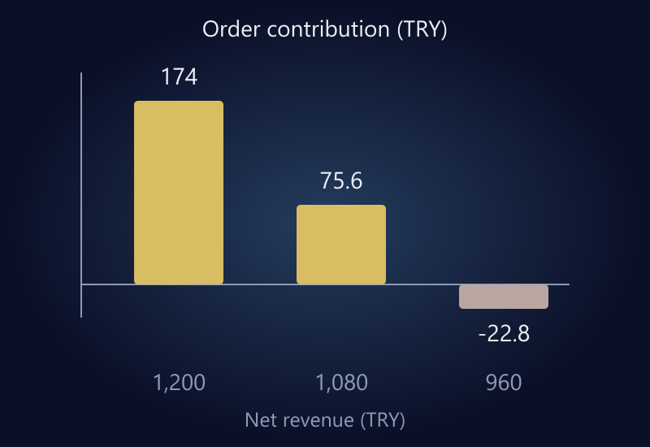

Ecommerce pricing is not simply a purchase cost plus a percentage. Revenue-based fees, order handling, customer acquisition, returns, and fixed operating costs all affect what a sale contributes. Before approving a discount, ask how much contribution disappears, not just how much the price falls.

A useful pricing decision answers three different questions: What value does the customer receive? Does the price cover the relevant variable costs? Is the remaining contribution sufficient for the business? Competitor prices inform those questions, but cannot answer them on your behalf.

Every number in this guide is hypothetical. The fee assumptions do not represent a marketplace tariff, payment provider, or tax rate. Examples use Turkish lira because the business context is Türkiye, but the calculation method is currency-independent. Revenue and costs are on a consistent tax basis; consumer-facing prices and applicable tax obligations require separate verification.

## Margin and markup use different denominators

Consider a product costing TRY 300 and selling for TRY 450, with no other costs included yet. The difference is TRY 150. Markup on cost is 150 / 300 = 50%. Gross margin on revenue is 150 / 450, approximately 33.3%.

Confusing those figures can produce an unsafe discount limit. “There is 50% profit in this product” is an incomplete statement when advertising and selling costs have not been included. A purchase-to-sale spread is not the company's net profit.

[Shopify's product pricing guidance](https://help.shopify.com/en/manual/products/details/product-pricing/determine-pricing) considers cost and value among pricing approaches. The contribution model below helps establish an economic constraint within that decision. It cannot calculate what customers will be willing to pay.

## Create a cost dictionary before a pricing sheet

Separate product-level costs from order-level costs. A two-item order may require two units of stock but not twice the packaging. Shipping can change abruptly at a weight or volume threshold. Applying one average to every basket may hide important differences.

Keep revenue-based charges separate too. A percentage fee must be recalculated when the selling price changes. Carrying the original currency amount into a discounted scenario produces the wrong answer. Confirm the contractual basis of each charge rather than assuming every percentage applies to the same amount.

| Cost group | Example | Question to resolve |
|---|---|---|
| Product cost | Purchase and allocated inbound cost | Is the tax basis consistent? |
| Order handling | Packaging and subsidized delivery | Does basket size change it? |
| Revenue-based fee | Marketplace or payment charge | What amount is the fee applied to? |
| Acquisition | Advertising allocation per order | Is the customer and period scope consistent? |
| Risk allowance | Expected damage or return exposure | Is it updated from actual experience? |
| Fixed overhead | Payroll, software, rent | What must contribution support? |

A planning allowance for returns is not a substitute for tracking actual refunds and costs. Check that the same expense is not included both in a handling line and a risk allowance. Document what each row includes so another person can reproduce the calculation.

*In the hypothetical model, contribution falls faster than price. All values also appear in the table below.*

## A small discount can remove most of the contribution

Suppose net revenue is TRY 1,200, product cost is TRY 600, order handling is TRY 90, and acquisition allocation is TRY 120. Assume revenue-based charges total 18%. Fixed overhead and taxes are excluded from the contribution shown here.

| Item | Original price | 10% discount | 20% discount |
|---|---:|---:|---:|
| Net revenue | TRY 1,200 | TRY 1,080 | TRY 960 |
| Product cost | TRY 600 | TRY 600 | TRY 600 |
| Order handling | TRY 90 | TRY 90 | TRY 90 |
| Revenue-based fees | TRY 216 | TRY 194.40 | TRY 172.80 |
| Acquisition allocation | TRY 120 | TRY 120 | TRY 120 |
| Order contribution | **TRY 174** | **TRY 75.60** | **−TRY 22.80** |

The 10% price reduction removes approximately 56.6% of contribution under these assumptions. Maintaining the original total contribution would require 174 / 75.60, or about 2.30 times as many orders. That already demanding comparison assumes acquisition and other unit costs remain unchanged. It does not include extra operational capacity needed for the volume.

At a 20% discount, contribution is negative. More orders at the same unit economics increase the loss. Future repeat purchases might form part of an acquisition strategy, but they cannot be treated as guaranteed compensation for an immediate deficit.

If a supplier or platform funds part of a promotion, model the actual commercial arrangement separately. Record who pays the discount, how it is settled, and whether eligibility is conditional. Do not carry a temporary subsidy into the normal price model.

## Calculate a contribution floor

Costs that do not vary with price total TRY 810 in this simplified model: 600 + 90 + 120. With an 18% revenue-based fee, the price producing zero contribution within the included scope is:

**810 / (1 − 0.18) ≈ TRY 987.80.**

This is not the company's break-even price. It covers only the costs included in the model. Fixed overhead, tax, and unmeasured risks remain outside it. Labeling the result “a price that cannot lose money” would overstate what has been calculated.

For a target contribution of 15% of net revenue, the same assumptions give:

**810 / (1 − 0.18 − 0.15) ≈ TRY 1,208.96.**

The target percentage belongs in the denominator. Adding 15% directly to TRY 810 would not leave 15% of revenue as contribution. If fee and target assumptions leave no economically meaningful denominator, reconsider the target or cost model rather than forcing the spreadsheet to return a price.

## Coupons and free shipping are different offers

A percentage coupon reduces revenue across the eligible basket. A free-shipping threshold may encourage a larger basket, but it can also move the parcel into a more expensive delivery band. Higher average order value alone does not prove a better outcome.

Calculate at least three representative baskets: one item, two similar items, and a mixed basket with different parcel requirements. Apply coupons, shipping subsidies, and payment discounts in the same sequence used by the store. Otherwise your model may disagree with the checkout total.

Plan the end of the promotion. An expired offer remaining in an ad, a stale product feed, or an active coupon after the intended end date creates operational as well as pricing problems. A price change is a coordinated update, not just a new number in an admin screen.

## Read competitor prices as complete offers

Two listings may appear identical while differing in pack contents, warranty, variant, dispatch timing, or delivery charges. Poor matching can push your team to compete against an offer you do not actually sell.

If your offer has a meaningful difference, explain it in terms the customer can evaluate. A suitable bundle, reliable service, or useful support can justify a different price. Simply charging more without demonstrating value is not positioning.

Do not assume a competitor shares your procurement costs, funding arrangements, or commercial goals. If their visible price is below your contribution floor, that is a reason to investigate the offer and your economics, not an automatic instruction to match it.

The same selling price can also produce different contribution across marketplaces and your own store. Acquisition and fee structures vary. Keep channel comparisons on the same cost and revenue basis before deciding which price should apply where.

## Design a limited pricing test

Choose a product group, hypothesis, and evaluation period. “A bundle may increase basket value while preserving more contribution than a single-item discount” is a testable hypothesis. “Lower prices so sales go up” leaves scope and success undefined.

Record stock availability, advertising changes, and seasonal conditions before the test. Monitor conversion, order contribution, cancellations, returns, and total contribution. A higher conversion rate with lower overall contribution may be the wrong trade-off.

Set decision rules in advance. A campaign might stop when contribution falls below a defined floor or when remaining stock becomes insufficient for the promise. Clear rules prevent decisions from being improvised when the campaign gets busy.

Avoid claiming to have estimated precise price elasticity from a small sample. A limited test may reveal a useful direction without supporting a universal conclusion. Keep the evidence and its limitations together in the report.

For related context, the earlier guide to [traffic without sales](/en/blog/ecommerce-traffic-but-no-sales/) explains why a pricing change should not be used to conceal a checkout or measurement problem.

## Frequently asked questions

### What percentage should I add to product cost?

There is no universal percentage. Establish fees, acquisition cost, customer value, and the required contribution first. Then evaluate whether the resulting price is commercially plausible in the chosen channel.

### Does free shipping always increase sales?

No result is guaranteed, and the expense shifts to the business. Evaluate basket mix, shipping bands, conversion, and contribution together instead of celebrating a higher order value in isolation.

### Should I match a cheaper competitor at a loss?

Not automatically. Verify that the offers are comparable and check your own economic limits. You do not know the competitor's supplier terms or promotion funding merely from the visible price.

### Do these calculations show net profit?

No. They show contribution after defined variable costs. Fixed overhead, taxes, and other obligations need separate treatment. Actual financial reporting requires appropriate records and professional assessment.

## Start a promotion with an economic case

Price should produce a sustainable commercial outcome, not only a click or an order. Document the cost scope, contribution floor, campaign end conditions, and review method before launch.

To connect pricing, campaign results, and product performance, explore [data analysis and reporting](/en/data-analysis-reporting/) or [ecommerce website management](/en/ecommerce-website-management/). You can also [get in touch](/en/#iletisim) to discuss the cost structure and decisions your reporting needs to support.
