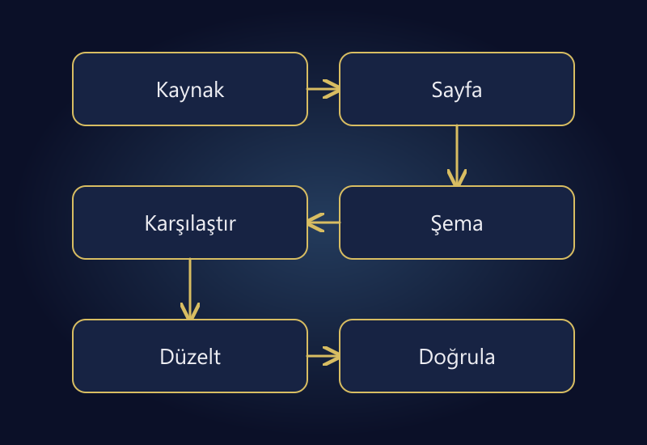

Google Merchant Center, ürün bilgilerinizi Google'ın ilgili alışveriş deneyimlerine iletmek ve yönetmek için kullanılan sistemdir. Ürün yüklemek, reklam kampanyası açmak veya satış garantisi almakla aynı şey değildir. Doğru ürün verisi, uygunluk ve çalışan bir mağaza birlikte değerlendirilmelidir.

Ürün reddedildiğinde ilk tepki aynı dosyayı tekrar yüklemek olmamalıdır. Önce sorunun ürün, veri kaynağı veya hesap düzeyinde olup olmadığını; hangi alanı ve hangi ürün kimliklerini etkilediğini belirleyin. Bir uyarıyı gidermekle görünürlüğün veya satışın otomatik artacağını varsaymayın.

Bu rehber, belirli bir hesapta başarı garantisi veren itiraz metni sunmaz. Sorunun kaynağını bulmak ve düzeltmenin gerçekten yayımlandığını doğrulamak için uygulanabilir bir inceleme sırası verir. Ekran isimleri ve süreçler değişebileceğinden hesabınızdaki güncel sorun açıklamasını ve resmî belgeyi esas alın.

## Merchant Center, Google Ads ve mağaza farklı katmanlardır

Mağazanız müşterinin ürün ve ödeme deneyimini sunar. Merchant Center ürün verisini işler. Google Ads ise reklam yönetimi katmanıdır. Birinin çalışması diğerinin doğru yapılandırıldığını kanıtlamaz. Mağazada ürün görünürken veri kaynağında eski fiyat bulunabilir; ürün uygun olduğu halde kampanya tarafında başka bir sorun olabilir.

[Google'ın ürün verisi şartnamesi](https://support.google.com/merchants/answer/7052112?hl=tr), alanların biçimini ve kullanım koşullarını tanımlar. Ürün kimliği, bağlantı, görsel, fiyat, stok ve varyant verileri ürünün gerektirdiği kapsamda doğru olmalıdır. Bütün alanlar için tek bir zorunluluk listesi üretmek yerine ürün türü ve hedeflenen kullanımın güncel şartlarını kontrol edin.

Bir çalışma dosyasında üç ayrı sütun tutun: mağazadaki değer, gönderilen değer ve Merchant Center'da işlenen değer. Sadece kaynak dosyayı incelemek, Google'ın en son hangi veriyi aldığını göstermeyebilir. Güncellemenin zamanını ve sonucunu da kayıt altına alın.

*Veri katmanlarını karşılaştırın; düzeltmeyi gönderim sonrası sonuçla doğrulayın.*

## Önce sorunun kapsamını belirleyin

Hesaptaki sorun açıklamasını ürün kimlikleriyle birlikte dışa aktarın veya güvenli biçimde kaydedin. Kaç ürün etkilendiğini, ortak kategori veya varyant yapısı olup olmadığını ve ilk gözlem zamanını not edin. Tüm kataloğu değiştirmeden önce bir örnek ürün üzerinden hatayı tekrar üretmeye çalışın.

| Sorun türü | İncelenecek kanıt | İlk yaklaşım |
|---|---|---|
| Eksik veya geçersiz alan | Kaynak satırı ve şartname | Alanı kaynağında düzeltmek |
| Fiyat veya stok uyuşmazlığı | Kaynak, sayfa ve yapılandırılmış veri | Üç değeri aynı duruma getirmek |
| Görsel veya bağlantı sorunu | Gerçek URL ve sunucu yanıtı | Erişimi ve ürüne uygunluğu doğrulamak |
| Varyant eşleşmesi | Ürün kimliği ve seçili varyant | Yanlış ürün açılışını düzeltmek |
| Hesap/politika sorunu | Hesaptaki tam açıklama | İlgili politikaya göre ayrı inceleme |

Bu sınıflandırma resmî itiraz sürecinin yerine geçmez. Aynı belirti farklı nedenlerden doğabilir. Örneğin fiyat uyuşmazlığı yalnızca yanlış veri değil, sayfanın varsayılan olarak farklı varyantı açması nedeniyle de görülebilir.

## Fiyatı üç yerde karşılaştırın

Varsayımsal bir örnekte kaynakta 1.250 TL, ürün sayfasında 1.150 TL, sayfanın yapılandırılmış verisinde 1.250 TL bulunduğunu düşünün. Yeni kampanya sayfaya uygulanmış fakat iki veri katmanı güncellenmemiştir. Görünür fiyatı tekrar yazmak kök nedeni çözmez.

[Google'ın fiyat uyuşmazlığı açıklaması](https://support.google.com/merchants/answer/9773429?hl=tr), kaynak, açılış sayfası ve yapılandırılmış veri tutarlılığını ele alır. Kampanyanın başlangıç/bitiş zamanını, para birimini ve seçili varyantı aynı kapsamda karşılaştırın. Üyelik veya koşula bağlı fiyatın herkese açık teklif gibi gönderilip gönderilmediğini de kontrol edin.

Önbellek ve zamanlama burada önemlidir. Panelde güncellenen fiyatın ziyaretçiye sunulan HTML'e ne zaman geçtiğini, veri kaynağının hangi sürümü çektiğini ve gönderimin başarılı olup olmadığını ayırın. Sadece “kaydet” düğmesine basılmış olması uçtan uca güncelleme kanıtı değildir.

Örnek fiyatları gerçek bir hesapta taklit etmeyin. Ama kendi ürününüz için aynı üçlü karşılaştırmayı yapın. Bir ekran görüntüsüyle kaynak satırını ve kontrol zamanını eşleştirmeniz, destek ekibiyle iletişimi daha somut hale getirir.

## Stok ve varyant hatalarını kimlikle çözün

Aynı modelin farklı bedenleri veya renkleri ayrı satılabilir kayıtlar olabilir. Kırmızı/38 varyantı gönderilip bağlantıda mavi/40 açılıyorsa genel ürün başlığı doğru olsa bile müşteri yanlış teklife iner. Kimlik, varyant, URL ve stok ilişkisini birlikte denetleyin.

SKU ile barkodu aynı kavram sanmayın. İşletme içi kodunuz, üretici tarafından atanmış tanımlayıcıyla aynı şey olmayabilir. Eksik alanı doldurmak için GTIN uydurmayın veya başka üründen kopyalamayın. Ürünün gerçek tanımlayıcı durumunu ve güncel alan şartlarını inceleyin.

Stok güncellemesini de ürün adıyla eşleştirmeyin. Başlıklar değişebilir veya aynı olabilir. Satılabilir kaydın kalıcı kimliği, kanal eşleşmesi ve son başarılı güncelleme zamanı görünür olmalıdır. Bu hazırlık, [ERP entegrasyonu](/erp-entegrasyonu/) tarafındaki veri sözlüğüyle birlikte yapılabilir.

## Görsel ve bağlantıyı gerçekten açın

Bir görselin panelde görünmesi, herkese açık URL'nin sorunsuz erişildiğini kanıtlamaz. Oturum gereksinimi, süresi dolan bağlantı, hatalı yönlendirme veya yanlış görsel dosyası bulunabilir. Ürün bağlantısını da oturum kapalıyken ve mobil görünümde kontrol edin.

Görsel, satılan ürünü doğru temsil etmelidir. Varyantta başka renk, pakette başka adet gösteriliyorsa yalnızca teknik erişim sorunu yoktur; teklif tutarsızlığı vardır. Görsel üzerine yoğun tanıtım metni eklemek veya yanlış ürünü göstermek yerine güncel görsel politikalarını inceleyin.

Sunucu korumalarını toptan kaldırarak erişim sorununu çözmeye çalışmayın. Sorunun hangi URL'de, hangi yanıtla ve hangi koşulda oluştuğunu belirleyin. Güvenlik duvarı veya bot koruması gerekiyorsa yetkili teknik kişiyle dar kapsamlı bir çözüm uygulayın.

## Eski API talimatlarını kopyalamayın

Google'ın [Merchant API güncellemeleri](https://developers.google.com/merchant/api/latest-updates), Content API for Shopping'in 18 Ağustos 2026'da kullanım sonuna ulaştığını bildirir. Bu nedenle yeni bir entegrasyon tasarlarken eski Content API örneklerini güncel yöntem gibi kullanmayın. Mevcut sağlayıcınızın hangi API ve sürümle çalıştığını açıkça sorun.

Bir entegrasyon yalnızca istek göndermekten oluşmaz. Yanıt, hata, yeniden deneme ve işlenen ürün sonucu izlenebilmelidir. Başarısız isteği sessizce atlayan bir sistem, katalogdaki sorunu günlerce görünmez kılabilir. Hata kayıtlarında erişim anahtarı veya müşteri bilgisi bulundurmayın.

Bu yazı API kurulum kılavuzu değildir. Altyapı seçimi, yetki kapsamı ve veri hacmine göre teknik tasarım gerekir. Gerekli olmayan özel entegrasyon geliştirmek yerine mevcut güvenilir bağlantının doğru çalışıp çalışmadığını önce kontrol edin.

## Düzeltmeyi sınırlı örnekle doğrulayın

Bir sorunu tüm katalogda değiştirmeden önce benzer ama farklı koşullardaki birkaç ürün seçin: tek varyant, çok varyant, kampanyalı fiyat, stok dışı ürün gibi. Her biri için önceki değer, yapılan düzeltme, gönderim zamanı ve işlenmiş sonuç kaydedilsin.

Başarılı gönderim ile onaylanmış uygunluğu aynı sonuç olarak raporlamayın. İşlenme veya inceleme süresi kesin dakika garantisi vermez. Hesaptaki resmî inceleme adımlarını takip edin; değişiklik yapmadan tekrar tekrar başvuru göndermek yerine kanıtı tamamlayın.

Sorun tek ürünle sınırlı değilse aynı şablonu kullanan diğer kayıtları kontrol edin. Ancak rastgele alanları boşaltarak veya ürün kimliklerini yeniden oluşturarak temiz bir başlangıç yaptığınızı sanmayın. Kimlik değişikliği başka eşleşmeleri ve raporlamayı etkileyebilir.

## Tekrarını önlemek için küçük bir kontrol listesi

- Fiyat ve stok için yetkili veri kaynağı belirli mi?
- Kaynak dosyasının oluşturulma ve son başarılı gönderim zamanı izleniyor mu?
- Varyant bağlantısı doğru seçeneği açıyor mu?
- Kampanya bitişinde sayfa, kaynak ve yapılandırılmış veri birlikte güncelleniyor mu?
- Görsel ve ürün URL'leri oturum gerektirmeden erişilebilir mi?
- Hatalı kayıtlar sessizce geçilmek yerine sorumlu kişiye bildiriliyor mu?
- Güncel API ve politika belgeleri üzerinden bakım yapılıyor mu?

Bu listeyi sadece ilk kurulumda değil, tema değişikliği, kampanya ve entegrasyon güncellemesinden sonra da uygulayın. Sorunsuz çalışan bir ürün veri hattı, reklam ekibinin yanlış veriyi kampanya ayarıyla düzeltmeye çalışmasını önler.

## Sık sorulan sorular

### Merchant Center'a ürün eklemek reklam vermek midir?

Hayır. Ürün verisi yönetimi ile reklam kampanyası yönetimi farklı katmanlardır. İlgili görünürlük için veri uygunluğu ve kullanacağınız programın koşulları ayrıca değerlendirilir.

### Reddedilen ürünü silip yeniden eklemeli miyim?

Bunu varsayılan çözüm yapmayın. Önce hata nedeni ve kimlik ilişkileri incelenmelidir. Kaynağında düzeltilmeyen sorun yeni kayıtta da oluşabilir; gereksiz kimlik değişikliği ek sorun çıkarabilir.

### Otomatik güncellemeler bütün veri sorunlarını çözer mi?

Hayır. Yardımcı özellikleri doğru kaynak verisinin yerine koymayın. Kaynak, sayfa ve yapılandırılmış veri arasındaki kalıcı uyumsuzluk teknik olarak giderilmelidir.

### Düzeltince ne zaman görünür olur?

Gönderim, işleme ve gerekirse inceleme adımları vardır. Belirli bir sürede kesin onay veya görünürlük vaadi verilemez. Hesabın güncel durumunu ve resmî yönergeleri takip edin.

## Katalog verisini reklam kalitesinin parçası sayın

Merchant Center sorunlarını yalnızca reklam panelinin görevi gibi görmek çözümü geciktirir. Fiyat, stok, varyant ve ürün içeriği mağaza operasyonuyla birlikte yönetilmelidir. Ticari teklifin tutarlılığı, ürünün doğru kişiye gösterilmesi kadar önemlidir.

Kampanya ve ürün verisinin birlikte incelenmesi için [reklam kampanya yönetimi](/reklam-kampanya-yonetimi/) hizmetini değerlendirebilir veya [iletişim bölümünden](/#iletisim) kullandığınız altyapıyı ve tam hata açıklamasını paylaşabilirsiniz.
