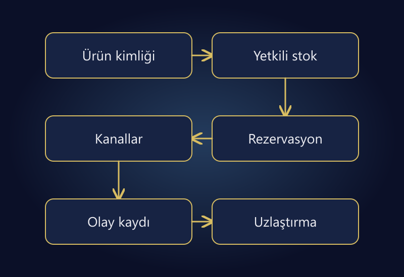

Pazaryeri ve kendi e-ticaret sitenizde stok senkronizasyonu, aynı sayıyı birkaç panele göndermekten daha kapsamlıdır. Satılabilir stoğun nasıl hesaplandığı, hangi sistemin yetkili olduğu ve sipariş, iptal, sevkiyat ile iadelerin ne zaman işleneceği açık olmalıdır. Aksi halde hızlı çalışan bir entegrasyon bile yanlış miktarı hızla dağıtır.

İyi bir sistemin hedefi yalnızca güncel görünen stok değildir. Aynı ürünün iki kanalda çakışan siparişlerle satılması, fiziksel sayım ile panelin ayrışması ve hatalı güncellemenin izlenememesi de yönetilmelidir. Hiçbir mimariyi incelemeden “anlık senkronizasyon, sıfır fazla satış” sözü vermek doğru olmaz.

Bu rehber, platform bağımsız bir kontrol modeli sunar. Kullandığınız ERP, depo yazılımı, pazaryeri ve mağaza altyapısının desteklediği işlem, API ve durumlar ayrıca doğrulanmalıdır. Örnek sayılar ve olaylar gerçek bir müşteri kaydı değildir.

## Fiziksel stok ile satılabilir stok farklıdır

Depoda bulunan her ürün satışa açık değildir. Başka siparişe ayrılmış, hasarlı, kalite kontrolünde veya güvenlik payı olarak tutulmuş miktarlar bulunabilir. Yoldaki tedarik de teslim alınmış ve kontrolden geçmiş stokla aynı şey değildir.

[Shopify'ın stok durumları belgesi](https://help.shopify.com/en/manual/inventory-and-locations/fundamentals/inventory-states), eldeki, satılabilir, taahhüt edilmiş, kullanılamayan ve gelen miktarları ayrı tanımlar. Bu adları başka yazılımlara birebir taşımayın; kendi sisteminizde hangi durumun hangi anlama geldiğini yazılı hale getirin.

Örnek modelimizde fiziksel stoktan ayrılmış siparişler, kalite/hasar miktarı ve ayrıca belirlenmiş güvenlik payı düşülür. Aynı miktarı iki farklı satırda düşmemek gerekir. Bir sistem güvenlik payını zaten kullanılamayan stok içinde tutuyorsa tekrar çıkarmak satılabilir miktarı gereksiz azaltır.

## Önce ürün eşleşmesini sağlamlaştırın

Başlık üzerinden eşleştirme kırılgandır. “Siyah tişört” farklı bedenlerde veya farklı paketlerde bulunabilir. Satılabilir her varyant için kalıcı bir iç kimlik ve bunun kanal karşılıkları gerekir. Ana ürün kimliği ile varyant kimliğini karıştırmayın.

| İç kayıt | Mağaza karşılığı | Pazaryeri karşılığı | Satılabilir birim |
|---|---|---|---|
| TSH-BLK-M | Siyah / M varyantı | Kanalın M varyant kaydı | 1 tişört |
| TSH-BLK-L | Siyah / L varyantı | Kanalın L varyant kaydı | 1 tişört |
| TSH-BLK-M-2 | İkili M paket kaydı | Kanalın ikili paket kaydı | 2 tişört |

Son satır bağımsız fiziksel stok olmak zorunda değildir; iki tekli üründen oluşan bir set olabilir. Böyleyse set satışı bileşen stoğunu doğru azaltmalıdır. Hem set hem tekli için aynı miktarı bağımsız stok sanmak, katalog doğru görünürken fazla satış yaratabilir.

Barkod ve SKU'ları sayı gibi işleyip baştaki sıfırları kaybetmeyin. Eşleşme dosyasının sürümü ve değişiklik kaydı bulunsun. Kullanıcının ürün başlığını düzenlemesi, stok ilişkisinin sessizce kopmasına yol açmamalıdır.

## Tek bir yetkili miktar kaynağı belirleyin

ERP veya depo sistemi yetkili olabilir; bazı işletmelerde mağaza sistemi bu rolü üstlenir. Önemli olan aynı alan için birden fazla sistemin birbirini döngüsel biçimde ezmemesidir. Kimin fiziksel sayımı, kimin rezervasyonu ve kimin kanal dağıtımını yönettiği anlaşılmalıdır.

“Pazaryerindeki stok 20 oldu, ERP'ye 20 yaz” yaklaşımı, kanal miktarının fiziksel miktar olmadığı bir yapıda yanlıştır. Kanal güncellemesiyle gelen siparişi de birbirinden ayırın. Sipariş talebi rezervasyon oluşturabilir; görüntülenen kanal sayısı ise sonuç verisidir.

Yetkili kaynak seçimini [ERP entegrasyonu](/erp-entegrasyonu/) gereksinimleriyle birlikte yapın. Bir alanda merkezileşmek, bütün süreçleri tek yazılıma taşımak zorunda olmak değildir. Fakat her veri için sorumlu sistem ve kişi tanımlanmalıdır.

*Kimlik, yetkili miktar ve rezervasyon netleşmeden kanal aktarımını hızlandırmayın.*

## Bir siparişi olay zinciri olarak düşünün

Örnek depoda 100 fiziksel birim, mevcut siparişlere ayrılmış 20, kalite/hasar için 10 ve ayrıca 5 güvenlik payı olsun. Satılabilir miktar 65'tir. Aşağıdaki modelde yeni sipariş önce ayrılır, sevk edilince fiziksel stoktan düşer.

| Olay | Fiziksel | Ayrılmış | Diğer kapalı miktar | Satılabilir |
|---|---:|---:|---:|---:|
| Başlangıç | 100 | 20 | 15 | 65 |
| Yeni 3 birimlik sipariş | 100 | 23 | 15 | 62 |
| Aynı siparişin sevki | 97 | 20 | 15 | 62 |

Sevk sırasında hem fiziksel miktar hem o siparişin rezervasyonu azalır. Yanlış tasarım aynı siparişi önce sipariş anında, sonra sevk anında ikinci kez satılabilir stoktan düşebilir. Bu tabloyu kendi sisteminizin olay adlarıyla kurarak çift düşüm riskini kontrol edin.

İptal edilen her siparişi otomatik olarak stoğa eklemek de güvenli değildir. Sipariş gerçekten ayrılmış mı, sevk edilmiş mi, kısmen iptal mi edilmiş? İade bildirimi geldiğinde ürün fiziksel olarak dönmüş ve yeniden satılabilir bulunmuş mu? Durum geçişi ve miktar birlikte değerlendirilmelidir.

## Aynı stoğu iki kanalda göstermek rezervasyon garantisi değildir

Merkezde 65 satılabilir birim bulunurken iki kanala da 65 göndermek, iki ayrı 65 birimlik depo yaratmaz. Siparişler güncellemeler tamamlanmadan çakışabilir. Kanal ve entegrasyonlar arasında tek bir atomik satış işlemi bulunduğunu varsaymayın.

Ürünün satış hızına ve bağlantının gecikmesine göre kanal bazlı tahsis veya kontrollü güvenlik payı düşünülebilir. Örneğin 40 ve 25 şeklinde tahsis, toplamı sınırlar ama boşta kalan stoğu bir kanalda tutabilir. Ortak havuz daha esnek olabilir; buna karşılık rezervasyon ve gecikme riski daha dikkatli yönetilmelidir.

Bir yöntem bütün ürünlere uygun değildir. Hızlı satılan düşük stoklu ürünle yavaş dönen yüksek stoklu ürün aynı kuralı gerektirmeyebilir. Güvenlik payını gerekçesiz büyütmek satış kaybını artırabilir; sıfırlamak da fazla satış riskini yükseltebilir.

## Hataları yeniden deneme mantığıyla büyütmeyin

Bağlantı zaman aşımına uğradığında istek başarısız olmuş olabilir veya karşı tarafta işlenip yanıtı kaybolmuş olabilir. Aynı siparişi tekrar işlemek ikinci rezervasyona yol açmamalıdır. Desteklenen sistemlerde olay/işlem kimliğiyle tekrarları tanıyan, aynı işin iki kez etkisini engelleyen tasarım gerekir.

Olayların sırası da önemlidir. Eski bir stok güncellemesi sonradan gelip daha yeni miktarı ezebilir. Platformun sunduğu sürüm, zaman veya koşullu güncelleme mekanizmaları incelenmelidir. Her API'nin bunları desteklediğini varsaymayın; desteklemiyorsa uzlaştırma ve istisna yönetimi gerekir.

“Entegrasyon çalışıyor” göstergesi yerine son başarılı işlem, hata sayısı ve bekleyen kayıtlar görünür olsun. Hata kaydı, hangi ürün ve olayın etkilenmiş olduğunu göstermeli; erişim anahtarlarını veya gereksiz müşteri bilgilerini içermemelidir.

## Uzlaştırma, entegrasyonun emniyet kontrolüdür

Anlık olay akışı olsa bile periyodik karşılaştırma yapın. Merkezde beklenen miktar, kanala son gönderilen miktar ve kanaldan okunan miktar arasında fark var mı? Farkın geçici gönderim gecikmesi mi, işlenmemiş sipariş mi, yoksa eşleşme hatası mı olduğu ayrılmalıdır.

Günlük raporda her ürünü kırmızı göstermek yerine yaş ve önem eşiği kullanın. Yeni gönderilmiş bir güncellemeyle saatlerdir başarısız olan kaydı ayırın. Eşikler gerçek satış hızınıza göre seçilmeli; bu yazı evrensel bir dakika hedefi önermez.

Fiziksel sayım farkını otomatik şekilde kanala yaymadan önce yetkili onayı gerekebilir. Yüksek tutarlı veya toplu miktar değişimlerinde önizleme ve geri alma kaydı tutun. Veri aktarım hızının, hatalı verinin etkisini de büyüttüğünü unutmayın.

## Canlıya geçmeden test edilecek senaryolar

1. Aynı varyanta iki kanaldan yakın zamanlı sipariş.
2. Aynı sipariş olayının ikinci kez gelmesi.
3. Kısmi iptal ve kısmi sevkiyat.
4. Sevk sonrası iade bildirimi, ardından fiziksel kabul.
5. Bağlantı kesintisi ve yeniden deneme.
6. Set ürün satışı ve bileşen stoğu.
7. Stok sıfıra düşmesi ve yeniden açılması.
8. Eşleşmesi olmayan veya baştaki sıfırı kaybolan kod.

Her senaryoda başlangıç miktarı, beklenen geçiş ve kanal sonucu yazılı olsun. Test yalnızca isteğin başarılı yanıt vermesiyle bitmesin. Son miktarı ve sipariş ilişkisini kontrol edin. Gerçek stok üzerinde deneme gerekiyorsa sınırlı kapsam ve yetkili onayıyla ilerleyin.

## Sık sorulan sorular

### ERP kullanmadan stok senkronizasyonu yapılabilir mi?

Evet, uygun bir mağaza veya entegrasyon sistemi merkez olabilir. ERP zorunluluğunu peşinen varsaymayın. Ürün, kanal, depo ve işlem hacmine göre ihtiyaç belirlenmelidir.

### Anlık entegrasyon fazla satışı tamamen engeller mi?

Garanti edilemez. Gecikme, çakışan sipariş ve platform yetenekleri değerlendirilmelidir. Rezervasyon, tahsis, güvenlik payı ve uzlaştırma birlikte tasarlanır.

### İade bildirimi gelince stok hemen açılmalı mı?

Her zaman değil. Ürünün fiziksel olarak dönmesi ve yeniden satılabilirliği kontrol edilmelidir. İade talebi ile depoya kabul farklı olaylardır.

### Stok farkını Excel'den toplu yükleyerek çözebilir miyim?

Kontrollü düzeltme için kullanılabilir, fakat kök neden giderilmezse fark tekrar oluşur. Kod eşleşmesini, veri sürümünü ve büyük değişiklikleri önizlemeden toplu aktarım yapmayın.

## Önce doğru miktarı, sonra hızlı aktarımı kurun

Stok senkronizasyonunun temeli net bir veri modeli ve olay sorumluluğudur. Yanlış tanımlanmış stoğu daha sık güncellemek güvenilirlik sağlamaz. Önce ürün eşleşmesini, rezervasyonları ve istisnaları açıklığa kavuşturun.

Mağaza ve kanal akışını birlikte değerlendirmek için [pazaryeri yönetimi](/pazaryeri-yonetimi/) ve [ERP entegrasyonu](/erp-entegrasyonu/) hizmetlerini inceleyebilir; sistemlerinizi ve yaşadığınız farkı [iletişim bölümünden](/#iletisim) paylaşabilirsiniz.
