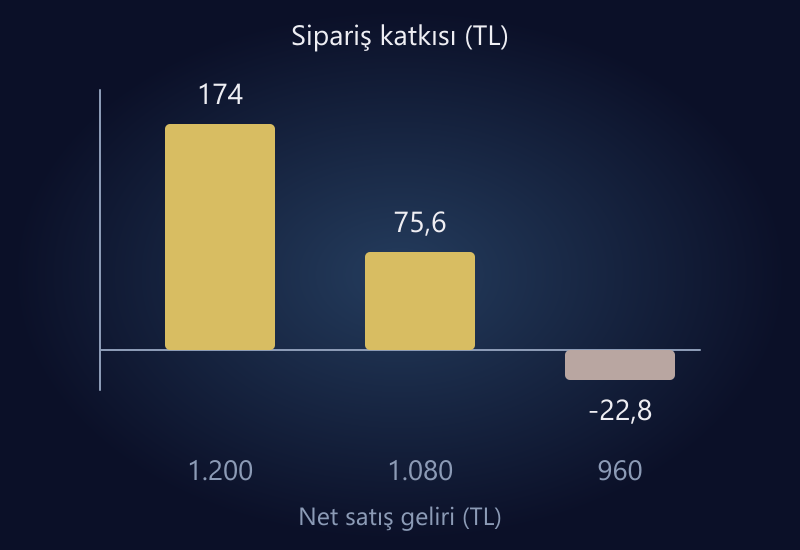

E-ticarette ürün fiyatlandırması, alış maliyetine bir yüzde eklemekten ibaret değildir. Satış fiyatına bağlı kesintiler, sipariş başına giderler, reklam, iadeler ve işletmenin sabit maliyetleri birlikte düşünülmelidir. Özellikle indirim kararı verirken fiyatın ne kadar düştüğünden önce siparişten kalan katkının ne kadar azaldığına bakın.

Sağlıklı yaklaşım üç soruyu ayrı yanıtlar: Ürün müşteriye hangi değeri sunuyor? Bu fiyatla siparişin değişken giderleri karşılanıyor mu? Kalan katkı, işletmenin sabit giderleri ve hedefi için yeterli mi? Rakip fiyatı bu sorularda bir girdidir; tek başına fiyat kararı değildir.

Bu rehberdeki bütün oranlar ve tutarlar varsayımsaldır. Belirli bir pazaryerinin güncel komisyonunu veya uygulanacak vergi oranını temsil etmez. Hesaplar aynı vergi bazında, örnek net satış geliri ve uyumlu maliyetlerle yapılır; müşteriye gösterilecek vergi dahil fiyat ve yasal yükümlülükler ayrıca doğrulanmalıdır.

## Kâr marjı ile maliyet üzerine eklenen oran aynı değildir

300 TL maliyetli bir ürünün 450 TL'ye satıldığını, yalnızca ürün maliyetini dikkate aldığımızı varsayalım. Fark 150 TL'dir. Maliyete göre eklenen oran 150 / 300 = %50, satış gelirine göre brüt marj ise 150 / 450 ≈ %33,3 olur.

Bu iki oranı birbirinin yerine kullanmak indirim sınırını yanlış hesaplatır. “Üründe %50 kâr var, %30 indirim yapabilirim” cümlesi özellikle reklam ve satış giderleri henüz eklenmediyse tehlikelidir. Ürünün alış-satış farkı, şirketin net kârı değildir.

[Shopify'ın fiyatlandırma rehberi](https://help.shopify.com/en/manual/products/details/product-pricing/determine-pricing), maliyet ve değer gibi farklı fiyatlandırma yaklaşımlarını bir arada değerlendirir. Burada kullanacağımız katkı hesabı, bu yaklaşımlar arasından seçim yaparken alt ekonomik sınırı anlamaya yarar. Müşterinin kabul edeceği fiyatı tek başına hesaplayamaz.

## Önce maliyet sözlüğünüzü oluşturun

Ürün başına alış maliyeti ile sipariş başına maliyeti ayırın. Aynı sepette iki ürün satıldığında paketleme gideri iki katına çıkmayabilir; ama ürün maliyeti artar. Kargo bedeli ağırlık veya hacim basamağında sıçrayabilir. Basit ortalamayı bütün sepetlere uygulamak gerçek tabloyu gizleyebilir.

Satış tutarına bağlı giderleri de ayrı tutun. Komisyon veya ödeme kesintisi fiyat değiştiğinde yeniden hesaplanır. Sabit 100 TL kesinti varsayıp indirimli fiyatı hesaplamak, oran bazlı gideri yanlış taşır. Sözleşmedeki kesintinin hangi tutara uygulandığını öğrenin.

| Maliyet grubu | Örnek | Kontrol sorusu |
|---|---|---|
| Ürün maliyeti | Alış, ürüne dağıtılmış tedarik gideri | Aynı vergi bazında mı? |
| Sipariş gideri | Paketleme, karşılanan kargo | Sepet ve bölgeye göre değişiyor mu? |
| Gelire bağlı kesinti | Örnek komisyon veya ödeme gideri | Hangi tutar üzerinden hesaplanıyor? |
| Müşteri kazanımı | Sipariş başına reklam payı | Aynı müşteri ve dönem kapsamı mı? |
| Risk payı | İade ve hasar için ayrılmış karşılık | Gerçek geçmişle güncelleniyor mu? |
| Sabit gider | Personel, yazılım, kira | Katkıdan karşılanacak yük ne? |

İade payını muhasebe kaydıyla karıştırmayın. Fiyat kararında risk görmek için kullanılan varsayım, gerçekleşen iadelerin izlenmesinin yerine geçmez. Aynı maliyeti hem gider satırında hem risk payında iki kez saymadığınızdan emin olun.

*Varsayımsal örnekte fiyat düşerken katkı daha hızlı azalır; bütün tutarlar aşağıdaki tabloda da bulunur.*

## İndirim sipariş katkısını nasıl değiştirir?

Örnek üründe net satış geliri 1.200 TL, ürün maliyeti 600 TL, sipariş gideri 90 TL ve reklam payı 120 TL olsun. Gelire bağlı toplam örnek kesinti %18 olarak varsayılsın. Sabit işletme giderleri ve vergiler aşağıdaki katkıya dahil değildir.

| Kalem | İndirimsiz | %10 indirim | %20 indirim |
|---|---:|---:|---:|
| Net satış geliri | 1.200 TL | 1.080 TL | 960 TL |
| Ürün maliyeti | 600 TL | 600 TL | 600 TL |
| Sipariş gideri | 90 TL | 90 TL | 90 TL |
| Gelire bağlı kesinti | 216 TL | 194,40 TL | 172,80 TL |
| Reklam payı | 120 TL | 120 TL | 120 TL |
| Sipariş katkısı | **174 TL** | **75,60 TL** | **−22,80 TL** |

Fiyatta %10 indirim, bu varsayımlarla katkıyı %10 değil yaklaşık %56,6 azaltır. Aynı toplam katkıyı korumak için 174 / 75,60 ≈ 2,30 kat sipariş gerekir. Üstelik bu hesap reklam payının ve diğer birim giderlerin değişmediğini varsayar; artan hacmin ek operasyon giderini kapsamaz.

%20 indirimde sipariş başına katkı negatiftir. Daha fazla sipariş almak, aynı koşullarda zararı büyütür. Kampanyanın gelecekte tekrar satın alma getireceğini varsayarak bu farkı kapatmış saymayın; böyle bir stratejinin maliyeti, riski ve sonradan ölçümü ayrıca tanımlanmalıdır.

## Fiyat tabanını formülle kontrol edin

Fiyata bağlı olmayan örnek birim gider toplamı 600 + 90 + 120 = 810 TL, gelire bağlı gider oranı %18 olsun. Bu kapsamda sıfır katkı fiyatı:

**810 / (1 − 0,18) ≈ 987,80 TL.**

Bu fiyat şirketin başabaş fiyatı değildir; yalnızca dahil edilen değişken giderleri karşılar. Sabit giderleri, vergiyi veya ölçülmeyen riskleri dışarıda bırakmıştır. Bu ayrımı yapmadan hesaplayıcı sonucuna “zarar etmeyen fiyat” etiketi koymayın.

Net satış geliri üzerinde %15 katkı hedeflenirse aynı modelde:

**810 / (1 − 0,18 − 0,15) ≈ 1.208,96 TL.**

Hedef oranı paydaya almak önemlidir. 810 TL'ye doğrudan %15 eklemek, gelirin %15'ini katkı olarak bırakmaz. Oranların toplamı ekonomik olarak anlamlı bir payda bırakmıyorsa hesap hedefinin veya maliyet modelinin yeniden değerlendirilmesi gerekir.

## Kupon ve ücretsiz kargo aynı kampanya değildir

Tüm ürünlerde yüzdesel indirim ile belirli sepet tutarına ücretsiz kargo farklı davranışlar üretir. Kupon, yüksek katkılı ürünün gelirini azaltabilir. Kargo eşiği ortalama sepeti artırabilir ama hacim/ağırlık basamağını da yükseltebilir. Sonucu yalnızca sepet ortalamasıyla değerlendirmeyin.

Bir kampanyayı en az üç örnek sepette hesaplayın: tek ürün, iki benzer ürün, farklı hacimli karışık sepet. Kuponların birleşmesi, ücretsiz kargo, ödeme indirimi ve kampanya katkıları varsa bunları aynı sırayla uygulayın. Mağaza ekranıyla hesap dosyasının farklı indirim sırası kullanması tutarsızlık yaratır.

Kampanya bitişini de planlayın. Eski kuponun aktif kalması, ürün kaynağındaki fiyatın geç güncellenmesi veya reklamda eski fiyatın görünmesi ekonomik ve operasyonel sorun oluşturur. Fiyat değişikliği, yalnızca panelde yeni rakam yazmak değildir.

## Rakip fiyatını teklif kapsamıyla birlikte okuyun

Aynı ürün gibi görünen iki ilanda garanti, paket içeriği, varyant, teslimat ve satıcı koşulları farklı olabilir. Ucuz görünen ilanın kargosu ayrıca tahsil ediliyor olabilir. Doğru eşleştirme yapmadan fiyat takibi, sizi yanlış rekabete sokar.

Farkınız varsa bunu müşterinin anlayacağı biçimde gösterin. Daha iyi anlatılmış bir hizmet, uygun paket veya güvenilir teslimat fiyatı destekleyebilir; fakat değeri kanıtlamadan yalnızca daha pahalı olmak bir strateji değildir. Rakibin fiyatı maliyet tabanınızın altındaysa aynı fiyatı sürdürebileceğiniz varsayılmamalıdır.

Pazaryeri ile kendi sitenizde aynı fiyatın aynı katkıyı bırakmasını da beklemeyin. Kanalın kesinti ve müşteri kazanım yapısı farklıdır. Kanal kararını [Trendyol ve bağımsız site karşılaştırmasıyla](/blog/trendyol-mu-kendi-e-ticaret-sitesi-mi/) birlikte değerlendirebilirsiniz.

## Küçük kapsamlı bir fiyat testi tasarlayın

Bir ürün grubunu, açık bir hipotezi ve değerlendirme dönemini seçin. Örneğin “paket seçeneği, tek ürün indirimine göre sipariş katkısını korurken sepet tutarını artırabilir” bir test hipotezidir. “Fiyatı düşürelim, satış artsın” ise sınırları belirsiz bir taleptir.

Fiyat değişiminden önce stok yeterliliğini, reklam değişikliklerini ve sezon etkisini kaydedin. Testte dönüşüm, sipariş katkısı, iptal/iade ve toplam katkıyı birlikte izleyin. Daha yüksek dönüşümün daha yüksek kârlılık anlamına gelmediğini [ROAS rehberindeki](/blog/roas-nedir-karli-mi/) mantıkla da kontrol edin.

Karar kuralını önceden yazın. Katkı alt sınırın altına düşerse kampanyayı durdurma, stok belirli seviyeye gelirse kapsamı daraltma gibi kurallar operasyonun tahminle ilerlemesini azaltır. Düşük veriyle kesin fiyat esnekliği çıkardığınızı iddia etmeyin.

## Sık sorulan sorular

### Maliyetin üzerine yüzde kaç koymalıyım?

Tek bir doğru oran yoktur. Kesintiler, müşteri kazanımı, ürünün değeri ve sabit gider ihtiyacı birlikte değerlendirilmelidir. Önce gider kapsamını kurun, sonra fiyatın müşteri ve kanal açısından uygulanabilirliğini test edin.

### Ücretsiz kargo her zaman satış artırır mı?

Garanti değildir. Müşteri için avantajlı olabilir ama maliyeti işletmeye geçer. Hacim, ürün karması ve sipariş katkısı değişimini birlikte izleyin. Sadece daha yüksek sepet tutarına bakmayın.

### Rakibim daha ucuza satıyorsa zararına eşleşmeli miyim?

Otomatik olarak hayır. Ürün ve teklif kapsamını doğrulayın, sonra kendi maliyet tabanınızı kontrol edin. Rakibin tedarik maliyetini veya kampanya finansmanını bildiğinizi varsaymayın.

### Bu hesaplar net kârı gösteriyor mu?

Hayır. Örnekler tanımlı değişken giderler sonrası katkıyı gösterir. Sabit giderler, vergiler ve başka yükümlülükler ayrıca değerlendirilir. Gerçek muhasebe sonucu için mali kayıtlar ve uzman değerlendirmesi gerekir.

## Kampanyaya fiyatla değil, hesapla başlayın

Fiyatın görevi sadece tıklama veya sipariş almak değildir; işletmenin sürdürebileceği bir ekonomik sonuç üretmektir. Her kampanya için maliyet kapsamını, katkı tabanını, bitiş koşulunu ve izleme yöntemini yazılı hale getirin.

Fiyat, kampanya ve ürün raporlarını birlikte değerlendirmek için [veri analizi ve raporlama](/veri-analizi-raporlama/) veya [e-ticaret sitesi yönetimi](/e-ticaret-sitesi-yonetimi/) hizmetlerini inceleyebilir; mevcut maliyet yapınızı [iletişim bölümünden](/#iletisim) paylaşabilirsiniz.
