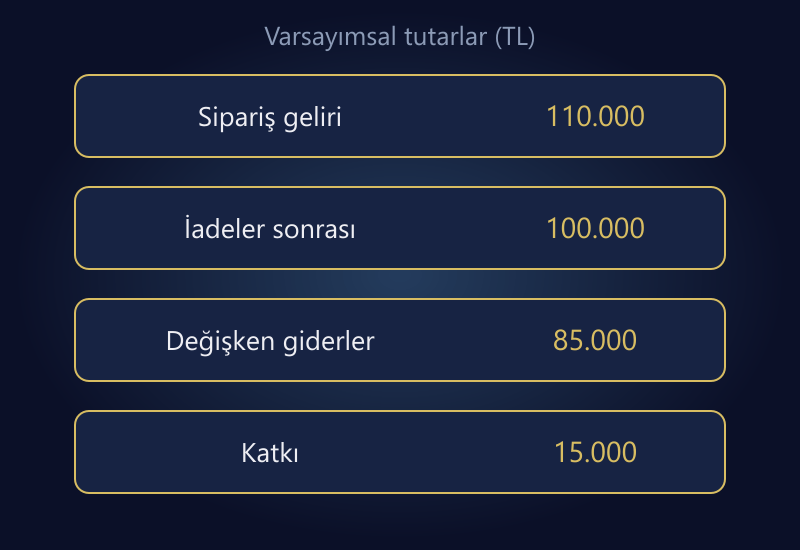

E-ticarette iyi bir yönetim paneli, mümkün olan en fazla KPI'ı gösteren panel değildir. Hangi kararın alınacağını, verinin neyi kapsadığını ve hangi koşulda müdahale gerektiğini açıklaştıran paneldir. Ciro artarken katkı düşüyorsa veya reklam iyi görünürken iade yükü büyüyorsa yalnızca satış grafiği yeterli olmaz.

Başlangıç için satış, müşteri kazanımı, sipariş katkısı, iade, teslimat ve stok başlıklarını birlikte izleyin. Her göstergenin sahibi, tanımı, veri kaynağı ve güncellenme sıklığı bulunmalı. Raporun sonunda “ne yapacağız?” sorusu yanıtsız kalıyorsa daha fazla grafik eklemek sorunu çözmez.

Bu rehberdeki panel ve sayılar varsayımsaldır. Sektör ortalaması veya belirli bir işletmenin performansı değildir. Özellikle gelir ve maliyet kapsamını açık tutarak aynı sayının farklı raporlarda neden farklı görünebileceğini anlatır.

## Önce metrik sözlüğü oluşturun

Ciro, sipariş, müşteri ve dönüşüm kelimeleri tek başına yeterli tanım değildir. Ciro vergi ve kargoyu içeriyor mu? İptal edilmiş sipariş sayılıyor mu? Müşteri hesabı olmayan misafir alışverişleri nasıl ele alınıyor? Dönüşüm paydasında oturum mu kullanıcı mı var?

[Google Analytics'in e-ticaret metrikleri açıklaması](https://support.google.com/analytics/answer/13428834?hl=en), işlem, satın alma ve ürün adedi gibi kavramların farklı kapsamları olabileceğini gösterir. Panelde kaynaklar arasında aynı adı taşıyan alanları tanımlarını okumadan birleştirmeyin.

Her metrik için kısa bir sözlük satırı yazın: ad, formül, dahil edilen kayıtlar, hariç tutulanlar, zaman dilimi, kaynak ve sorumlu kişi. Dönem kapanışında değişebilen tutarları da belirtin. Geç gelen iade, önceki haftanın sonucunu değiştirebilir; bu bir hesap hatası olmak zorunda değildir.

## Bir örnek paneli aynı veri kapsamıyla okuyun

Örnek dönemde 6.000 uygun oturum, 120 satın alan oturum ve 120 ödenmiş sipariş olsun. Ürün satış tutarı indirim öncesi 120.000 TL, indirim 10.000 TL ve aynı sipariş grubuna ait iade tutarı 10.000 TL varsayılsın. Vergi ve kargo geliri bu gelir modelinin dışındadır.

| Gösterge | Hesap | Örnek sonuç |
|---|---|---:|
| Oturum dönüşümü | 120 / 6.000 | %2 |
| İndirim sonrası sipariş geliri | 120.000 − 10.000 | 110.000 TL |
| Sipariş anındaki ortalama tutar | 110.000 / 120 | 916,67 TL |
| İadeler sonrası korunan ürün geliri | 110.000 − 10.000 | 100.000 TL |
| İlk sipariş başına korunan gelir | 100.000 / 120 | 833,33 TL |

Son iki ortalamayı aynı etiketle “ortalama sepet” diye göstermeyin. Biri sipariş anındaki tutarı, diğeri aynı grubun iadeler sonrası gelirini ifade eder. Ayrıca bu örnekte satın alan oturum ve sipariş sayısı eşittir; gerçek verinizde bir oturum birden fazla sipariş içeriyorsa tanımları ayrı tutun.

Paneldeki her satırın yanına dipnot doldurmak yerine tanımlara ulaşılabilir bir alan ekleyin. Ekip aynı KPI'ı farklı hesaplıyorsa önce sözlüğü düzeltin. Tasarımın şık olması tanım çelişkisini ortadan kaldırmaz.

*Örnek tutarlar gelirden katkıya geçişi gösterir; gider kapsamı ve hesap aşağıda açıklanmıştır.*

## Ciroyu sipariş katkısıyla tamamlayın

Korunan gelir 100.000 TL, satılan ve iade sonrası elde tutulmuş ürünlerin maliyeti 50.000 TL, değişken operasyon ve satış giderleri 15.000 TL, medya harcaması 20.000 TL olsun. Örnekte iade işleme etkileri ilgili maliyet satırlarına tutarlı şekilde dahil edilmiştir; ikinci kez düşülmez.

**100.000 − 50.000 − 15.000 − 20.000 = 15.000 TL katkı.**

Bu sonuç sabit gider ve vergi öncesidir. “Net kâr” etiketiyle sunulamaz. Bir önceki dönemde daha düşük ciroyla daha fazla katkı kaldıysa büyümenin ürün karması, indirim ve gider etkileri incelenmelidir.

Reklam panelindeki ROAS'ı bu tabloyla karıştırmayın. Platformun atfettiği gelir, işletmenin aynı sipariş grubunda koruduğu gelirle aynı kapsamda olmayabilir. Örnekte korunan ürün gelirinin medya harcamasına oranı 5'tir; bu oranı platform ROAS'ı diye yeniden adlandırmıyoruz. [ROAS rehberi](/blog/roas-nedir-karli-mi/) bu ayrımı daha ayrıntılı ele alır.

## Müşteri kazanımını yalnızca ucuz siparişle değerlendirmeyin

CPA ölçerken paydanın ne olduğunu yazın: platformun atfettiği satın alma mı, doğrulanmış ödenmiş sipariş mi? Yeni müşteri edinme maliyeti hesaplanıyorsa yeni müşterinin nasıl belirlendiği de açıklanmalıdır. Tekrarlayan siparişleri yeni müşteri gibi saymak tabloyu yapay biçimde iyileştirir.

Müşteri kimliği eksik veya dağınıksa yaşam boyu değer için kesin bir rakam üretmeyin. Önce tutarlı müşteri eşleştirmesi ve yeterli gözlem süresi gerekir. Tahmini gelecekteki geliri bugün elde edilmiş katkıyla aynı kartta toplamak karar riskini artırır.

Kanal raporunda reklamın yanında organik, doğrudan ve diğer kaynakları da görün. Atıf farklılıkları nedeniyle platform gelirlerini birbirine ekleyip işletme toplamı gibi kullanmayın. Raporun amacı kanalların kendi kendini haklı çıkarması değil, toplam ekonomiyi anlamaktır.

## İadeyi adet ve tutar olarak ayrı izleyin

Örnekte 120 siparişten sekizinin iade içerdiğini varsayalım. Sipariş bazlı iade payı 8 / 120 ≈ %6,67'dir. İade edilen tutarın indirim sonrası gelire oranı ise 10.000 / 110.000 ≈ %9,09'dur. Bunlar farklı sorulara yanıt verir.

İade talep tarihiyle ilk satış tarihini aynı raporda dikkatsizce karıştırmayın. Bu ay gelen iade geçen ayın satışına ait olabilir. Sipariş grubuna göre analiz yapmakla dönem içindeki nakit iade hareketini raporlamak farklıdır. İkisi de gerekli olabilir; isimleri ve kapsamları açık olmalıdır.

[Google'ın e-ticaret olay rehberi](https://developers.google.com/analytics/devguides/collection/ga4/ecommerce), iade olayında ilgili işlem kimliğinin kullanılmasını açıklar. Analytics kurulumu olsa bile gerçek mali sonuç için ödeme ve sipariş kayıtlarıyla uzlaştırma gerekir. İade kaydı göndermek fiziksel stok veya muhasebe sürecini otomatik olarak düzeltmez.

## Operasyon ve stok panelin dışında kalmasın

Teslim edilmesi gereken 100 siparişin 92'si tanımlanmış teslimat süresi içinde tamamlandıysa zamanında teslim oranı %92'dir. Henüz vadesi gelmemiş 20 siparişi paydaya ekleyip oranı düşürmeyin. “Zamanında” tanımı müşteriye verilen vaade dayanmalıdır.

Stok tarafında yalnızca toplam ürün adedi değil, satışa kapalı miktar, stokta yokluk ve kritik farklar da izlenmelidir. Satılabilirliği olmayan ürünlere reklam vermek, reklam panelinde değil stok sürecinde başlayan bir sorundur. [Stok senkronizasyonu rehberi](/blog/pazaryeri-e-ticaret-stok-senkronizasyonu/) bu ayrımı açıklamak için kullanılabilir.

Örnek 30 günlük dönemde satılan ürün maliyeti 50.000 TL ve ortalama stok maliyeti 25.000 TL ise dönem devri 2, basit ortalama stok süresi 15 gündür. Bu geçmiş dönem hesabıdır; gelecek ay aynı satış hızının garantisi değildir. Sezon ve dönem içi stok hareketlerini ayrıca değerlendirin.

## Günlük ve aylık ekranı ayırın

Günlük operasyon ekranında ödeme hatası, başarısız entegrasyon, kritik stok farkı ve geciken sipariş gibi müdahale gerektiren göstergeler öne çıkabilir. Aylık yönetim ekranında ürün katkısı, kanal ekonomisi, iade eğilimi ve stok verimliliği daha önemlidir.

| Gösterge grubu | İnceleme sıklığı örneği | Verilecek karar |
|---|---|---|
| Ödeme ve aktarım hataları | Operasyon ihtiyacına göre günlük | Sorunu sınırlamak ve gidermek |
| Kritik stok farkları | Satış hızına uygun sıklıkta | Kanal miktarını veya rezervasyonu düzeltmek |
| Ürün katkısı | Haftalık/aylık kapanış | Fiyat, kampanya ve ürün karması |
| İade nedenleri | Yeterli veri biriktikçe | Ürün bilgisi veya operasyon iyileştirmesi |
| Kanal ve müşteri ekonomisi | Tutarlı dönemlerle | Bütçe ve büyüme önceliği |

Bu sıklıklar evrensel hizmet seviyesi değildir. İşletmenin hacmine ve veri gecikmesine göre uyarlanmalıdır. Dün gelen veriyi bugünün anlık verisi gibi gösteren panel, güncelleme saatini sakladığı için yanlış karar üretebilir.

## Her kırmızı göstergeye bir sahip ve aksiyon ekleyin

Eşik aşıldığında kimin inceleyeceği belli değilse renkli alarm dekorasyondur. Her önemli KPI için sorumlu kişi, ilk kontrol ve düzeltme yolu tanımlayın. Çok sayıda yanlış alarm, ekibin gerçek sorunu da gözden kaçırmasına neden olabilir.

KPI hedeflerini değiştirirken geçmiş tanımı saklayın. Örneğin iptal siparişlerini hesap dışına çıkaran yeni bir formül, eski dönemle doğrudan karşılaştırılamaz. Formül sürümü ve yürürlük tarihi kayıtlı olsun. Yönetim paneli de operasyon yazılımı kadar bakım ister.

## Sık sorulan sorular

### İlk panelde kaç KPI olmalı?

Sabit bir doğru sayı yoktur. Başlangıçta karar üreten az sayıda gösterge seçin. Tanımı ve sahibi olmayan kartları eklemek yerine satış, katkı, iade, teslimat ve stok sorularını kapsayın.

### Analytics mi mağaza paneli mi doğru?

Kapsamları farklı olabilir. Mali ve operasyonel doğrulamada sipariş/ödeme kayıtları; trafik ve davranış analizinde uygun ölçüm sistemi kullanılır. Farkları tanımlamadan tek bir ekranı bütün sorular için otorite ilan etmeyin.

### Yüksek ciro iyi performans demek mi?

Tek başına hayır. İndirim, ürün maliyeti, reklam, iade ve operasyon giderleri sonucu değiştirebilir. Ciroyu katkı ve nakit etkisiyle birlikte değerlendirin.

### Yeni bir dashboard aracı satın almak gerekiyor mu?

Her zaman değil. Tutarlı veri sözlüğüyle kontrollü bir tablo başlangıç için yeterli olabilir. Önce karar ve veri ihtiyacını belirleyin; araç seçimi bunun ardından gelsin.

## Raporu karar sistemine dönüştürün

İyi panel, ekibe aynı sayıya bakma imkânı vermekten öte aynı anlamı kullanma disiplini kazandırır. Ölçütlerin tanımlarını, kaynaklarını ve aksiyonlarını kurduğunuzda raporlar birbirleriyle yarışmak yerine işletme kararlarını destekler.

Sipariş, reklam ve operasyon verilerini ortak bir sözlükte birleştirmek için [veri analizi ve raporlama](/veri-analizi-raporlama/) hizmetini inceleyebilir veya [iletişim bölümünden](/#iletisim) hangi kararları vermekte zorlandığınızı paylaşabilirsiniz.
