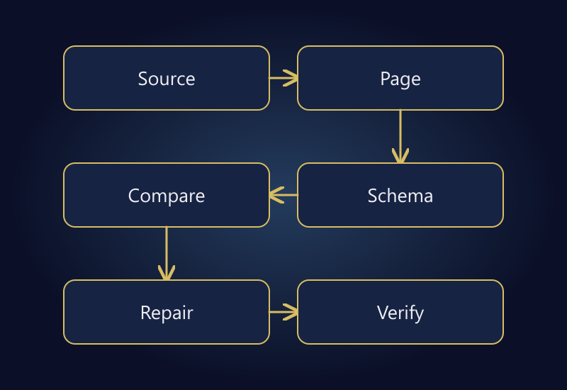

Google Merchant Center is used to submit and manage product information for Google's shopping experiences. Uploading a catalog is not the same as launching an advertising campaign, and neither action guarantees sales. Product data, eligibility, and a functioning store must work together.

When an item is disapproved, repeatedly uploading the same file is rarely a useful first step. Determine whether the issue concerns a product, data source, or account. Identify the affected attributes and item IDs before making changes across the entire catalog.

This guide provides a practical investigation sequence, not a guaranteed appeal script. Interface labels and review processes can change. Use the current issue description in your account and the relevant official documentation as the authority for a specific case.

## Separate the store, Merchant Center, and Google Ads

The store provides the product and checkout experience. Merchant Center processes product information. Google Ads manages advertising. A working storefront does not prove the submitted feed is current, and an eligible product does not prove every campaign setting is correct.

[Google's product data specification](https://support.google.com/merchants/answer/7052112?hl=en) defines attributes and their conditions. IDs, links, images, prices, availability, and variant information need to match the applicable requirements. Do not assume one universal checklist covers every product type and destination.

Create a review sheet with three columns: the value on the website, the submitted value, and the processed value in Merchant Center. Include timestamps. The file you most recently generated may not be the version Google has most recently received or processed.

Assign ownership to those layers. If merchandising edits the site, an integration creates the feed, and marketing monitors the account, someone must connect the evidence. Otherwise each team can report that its own screen looks correct while the customer-facing offer remains inconsistent.

*Compare the data layers and verify the processed outcome after making a correction.*

## Classify the issue before editing data

Record the exact issue message, affected IDs, observed time, and any common category or variant pattern. Reproduce one example before changing thousands of products. Keep screenshots and exports free of unnecessary customer or access information.

| Issue type | Evidence to inspect | First workstream |
|---|---|---|
| Missing or invalid attribute | Submitted row and specification | Correct the source |
| Price or availability mismatch | Feed, page, structured data | Align the offer |
| Image or URL problem | Actual URL and response | Verify access and relevance |
| Wrong variant | Item ID and selected option | Repair mapping and landing behavior |
| Account or policy issue | Complete account message | Review the applicable policy |

This triage table does not replace Google's review process. Similar symptoms can have different causes. A price mismatch might be a stale value, but it might also be a landing page opening the wrong variant by default.

## Compare price in three places

Imagine a hypothetical product with TRY 1,250 in the feed, TRY 1,150 visibly displayed on the page, and TRY 1,250 in structured data. A promotion has reached the storefront but not the other two layers. Re-entering the visible price is unlikely to fix the underlying update path.

[Google's price inconsistency guidance](https://support.google.com/merchants/answer/9773429?hl=en) discusses alignment between product data, landing pages, and structured data. Check campaign timing, currency, and variant on the same basis. A conditional or member-only offer should not be mistaken for an unconditional public price.

Investigate caching and update timing. When did the admin change become publicly visible? Which source version was fetched? Did the submission succeed? Clicking save in one system is not evidence of a completed end-to-end update.

Use your own product's actual values rather than reproducing the example amounts. Pair the source row with the public page and inspection time. This gives a developer or support team something more specific than “Google has the wrong price.”

## Resolve variants through stable identities

A model offered in different colors or sizes may have separate sellable records. If a red size-38 item opens a blue size-40 option, the general product title can look correct while the offer is wrong. Inspect ID, variant, URL, and availability together.

Do not treat an internal SKU and a manufacturer-assigned identifier as interchangeable. Never invent a GTIN or copy one from a different product merely to fill a field. Confirm the actual identification status and the current requirements for that item.

Do not synchronize by title either. Titles can change and may be duplicated. Stable sellable-item IDs, channel mappings, and successful-update timestamps are more useful foundations. This work often belongs alongside [ERP integration](/en/erp-integration/), not only in an advertising account.

Record what happens when a product is temporarily unavailable. Replacing its identity whenever stock changes can disrupt other relationships. Availability should be a controlled state change with traceable processing, rather than a sequence of unexplained new items.

## Open the real image and landing URL

An image appearing in an admin interface does not prove its public URL is available. A login requirement, expired link, unexpected redirect, or incorrect file can cause problems. Inspect the landing page while signed out and at a mobile viewport too.

The image must represent the actual offer. Showing a different color or a larger pack is not merely a technical access issue. It creates a mismatch between the customer's expectation and the product being sold. Check current image policies instead of covering weak source images with promotional text.

Do not disable security controls across the entire site to solve one access problem. Establish which URL fails, under what conditions, and with what response. A firewall or bot-protection issue should be resolved narrowly with an authorized technical owner.

## Avoid obsolete API instructions

Google's [Merchant API update log](https://developers.google.com/merchant/api/latest-updates) states that Content API for Shopping reached its sunset on August 18, 2026. New integration planning should therefore use current Merchant API documentation rather than old Content API tutorials. Ask an existing provider which API and version it actually uses.

Sending a request is only one part of an integration. Responses, failures, retries, and processed product outcomes need to be observable. An integration that silently drops failed requests can leave stale products undetected. Logs must not expose credentials or personal data.

This is not an API implementation tutorial. Authorization scope, platform capabilities, and catalog volume affect the design. Before commissioning a custom connection, verify whether an existing maintained integration already meets the requirement.

## Verify a repair on a controlled sample

Select representative items: a simple product, a multi-variant product, a sale item, and an unavailable item. Record the previous state, the repair, submission time, and processed result. This helps distinguish a corrected source from a successfully completed update.

Do not report successful transport as approved eligibility. Processing and review introduce separate stages, and neither should be assigned a guaranteed completion time. Follow the account's official review steps after the necessary corrections have been made.

Check related items using the same template when a sample exposes a systemic problem. However, do not clear random fields or recreate all IDs as a shortcut. Identity changes can affect mappings and reporting beyond the immediate warning.

## Build a repeatable maintenance checklist

- Is the authoritative source for price and availability documented?
- Can the team see when the source was generated and last submitted successfully?
- Does each variant URL open the intended option?
- Do promotion start and end updates reach all three data layers?
- Are public image and product URLs accessible without a customer session?
- Are failed updates surfaced to a responsible person?
- Is maintenance based on current API and policy documentation?

Repeat the checklist after theme changes, major promotions, and connector updates. Product data quality is an operational dependency of advertising. Campaign settings cannot reliably compensate for an inconsistent offer.

The earlier [pricing guide](/en/blog/ecommerce-product-pricing-discounts/) explains how discount economics and campaign end conditions fit together. Use it to coordinate the commercial plan with the technical update sequence, rather than treating them as unrelated tasks.

## Frequently asked questions

### Does adding products mean I am advertising?

No. Product information management and advertising campaign management are different layers. Eligibility and the conditions of the program you intend to use must be considered separately.

### Should I delete and recreate a disapproved product?

Not as a default response. Investigate the reason and identity relationships first. A problem that remains in the source may return immediately, while unnecessary ID changes create additional work.

### Can automatic updates solve every data issue?

No. Helpful features do not replace reliable source data. Persistent differences between the feed, landing page, and structured data need a proper technical repair.

### How soon will the item appear after a correction?

Submission, processing, and possible review are separate steps. No fixed approval or visibility time can be promised. Monitor the current account state and follow official guidance.

## Treat the catalog as part of advertising quality

Merchant Center issues are rarely solved sustainably by assigning every problem to the advertising team. Product information, pricing, availability, and variant behavior connect directly to store operations.

For a coordinated review of campaigns and product data, explore [advertising and campaign management](/en/advertising-campaign-management/) or [get in touch](/en/#iletisim) with your platform and the complete issue description. Clear evidence is a better starting point than an unsupported promise of approval.
