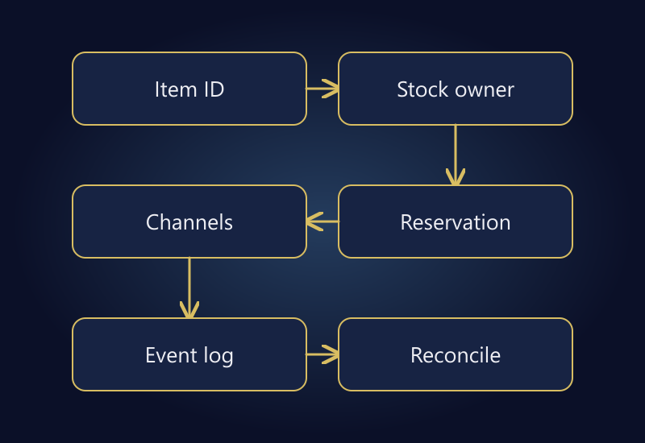

Inventory synchronization between a marketplace and your own store involves more than copying a number into several dashboards. You need a definition of available stock, an authoritative source, and explicit handling for orders, cancellations, shipments, and returns. A fast connection can distribute the wrong quantity just as efficiently as the right one.

The objective is not merely a current-looking number. The system must also handle competing orders, physical-count differences, and failed updates that would otherwise remain invisible. “Real-time integration means zero overselling” is not a credible promise without examining the actual architecture.

This guide presents a platform-independent control model. Your ERP, warehouse software, marketplace, and storefront may use different state names and API capabilities. The quantities and events below are hypothetical, not a customer case study.

## On-hand stock is not all available to sell

Some units may already be assigned to orders, damaged, awaiting inspection, or held as a safety buffer. Incoming supply is not the same as received and inspected stock. A total physical count therefore cannot automatically be sent to every sales channel as availability.

[Shopify's inventory-state documentation](https://help.shopify.com/en/manual/inventory-and-locations/fundamentals/inventory-states) distinguishes on-hand, available, committed, unavailable, and incoming quantities. Use that as an illustration of explicit states, not as a universal naming scheme for every platform.

Our example subtracts committed orders, quality or damage holds, and a separately defined safety buffer from physical stock. Avoid deducting the same units twice. If a system already includes safety stock within its unavailable quantity, a second safety deduction would understate availability.

## Establish stable product and variant mappings

Matching by title is fragile. “Black T-shirt” may exist in several sizes and pack configurations. Each sellable variant needs a stable internal identity and a documented mapping to the corresponding records in each channel.

| Internal record | Store mapping | Marketplace mapping | Sellable unit |
|---|---|---|---|
| TSH-BLK-M | Black / M variant | Channel's M variant | One shirt |
| TSH-BLK-L | Black / L variant | Channel's L variant | One shirt |
| TSH-BLK-M-2 | Two-pack M record | Channel's two-pack | Two shirts |

The two-pack may draw from the same component stock as individual shirts. If so, a bundle order must consume the correct component quantity. Treating both listings as independent physical pools can create overselling even when each catalog entry appears valid.

Keep identifiers as identifiers. Converting a barcode or SKU to a number can remove leading zeros. Maintain mapping versions and a change log so an ordinary title edit does not silently break inventory relationships.

## Decide which system owns each quantity

An ERP or warehouse system may be authoritative; a storefront may serve that role in a smaller operation. The important point is to prevent several systems from repeatedly overwriting the same field. Document who owns physical counts, reservations, and channel allocation.

A channel quantity is not necessarily a warehouse quantity. Reading “20 available” from a marketplace and writing it back as physical stock may corrupt the central record. An order event can create a reservation; the published channel count is an output of the inventory model.

Define ownership alongside your [ERP integration](/en/erp-integration/) requirements. Centralizing an individual field does not require moving every business process into one product. It does require a responsible system and person for each part of the data flow.

Avoid undocumented manual overrides. A temporary correction in one channel can be overwritten by the next scheduled update. If an exception is necessary, record its scope, expiry, and relationship to the authoritative source.

*Define identities, authoritative quantities, and reservations before accelerating channel updates.*

## Model the complete order lifecycle

Suppose a warehouse has 100 physical units, 20 committed to existing orders, 10 under quality or damage holds, and a separate safety buffer of five. Available stock is 65. A new order reserves units before shipment removes them physically.

| Event | Physical | Committed | Other held units | Available |
|---|---:|---:|---:|---:|
| Starting position | 100 | 20 | 15 | 65 |
| New order for three | 100 | 23 | 15 | 62 |
| Shipment of that order | 97 | 20 | 15 | 62 |

At shipment, physical stock and that order's commitment both fall. A flawed design may reduce availability at order creation and then reduce it again at shipment. Build this table using your actual systems' event names to expose double deductions.

Do not automatically add every cancellation back into stock. Was the order reserved, shipped, or only partly canceled? Similarly, a return request is not a warehouse receipt. Reopening availability may require physical acceptance and a sellability check.

Partial shipments and cancellations need line-level quantities. An order-level “canceled” label may not describe the state of every item. Make the quantity transition explicit rather than deriving it from a broad status name alone.

## Shared stock does not guarantee a shared atomic sale

Publishing 65 available units to two channels does not create two warehouses containing 65 each. Orders can overlap before updates finish. Do not assume the marketplace, storefront, and connector participate in one atomic reservation transaction.

Depending on sales velocity and integration delay, consider channel allocations or a controlled buffer. Allocating 40 units to one channel and 25 to another limits the total offer but can strand inventory in a slower channel. A shared pool offers flexibility while demanding stronger reservation and reconciliation controls.

One rule may not suit every SKU. A fast-selling item with very little stock has different exposure from a slow-moving item with a large balance. Excessive buffers can suppress sales; no buffer may increase risk. Choose the trade-off using observed behavior.

## Make retries safe and failures visible

A timed-out request may have failed, or it may have succeeded while its response was lost. Reprocessing the same order should not create a second reservation. Where supported, use stable event or operation identifiers to recognize repeats and prevent duplicate effects.

Ordering matters too. An older update arriving late can overwrite a newer quantity. Evaluate the platform's versioning, timestamps, or conditional-update capabilities. Do not assume every API provides them; missing capabilities may require additional reconciliation and exception handling.

Replace a vague “integration running” indicator with the last successful update, failed operations, and pending records. A useful error record identifies the affected item and event without exposing credentials or unnecessary customer details.

Assign an owner to unresolved exceptions. An alert sent to an unattended mailbox is not an operational control. The team should know who investigates a stalled update and when escalation is required.

## Reconcile even when events run continuously

Compare the expected central quantity, the last submitted channel quantity, and the quantity read back from the channel. Distinguish a recent in-flight update from a long-standing mapping error or unprocessed order.

Use age and commercial significance to prioritize differences. This guide does not prescribe a universal minute threshold. The appropriate tolerance depends on sales velocity, available stock, and the actual integration's behavior.

Physical-count corrections can have a large effect when distributed automatically. Consider preview and authorized approval for unusually large changes. Keep a recovery record. Faster data transport also increases the reach of incorrect data.

## Test transitions, not just successful requests

Before rollout, cover at least these cases:

1. Near-simultaneous orders for the same variant across channels.
2. Duplicate delivery of an order event.
3. Partial cancellation and partial shipment.
4. Return request followed later by warehouse acceptance.
5. Connection failure and retry.
6. Bundle purchase affecting component stock.
7. Stock reaching zero and reopening.
8. Missing mapping or an identifier with a lost leading zero.

For each case, record the starting quantities, expected transitions, and final channel values. A successful HTTP response is not the final acceptance criterion. If tests must affect real stock, use an authorized, tightly limited scope.

## Frequently asked questions

### Do I need an ERP to synchronize inventory?

Not necessarily. An appropriate storefront or integration service can be the central system. Choose based on products, channels, locations, and operational needs rather than assuming an ERP is always required.

### Does real-time synchronization eliminate overselling?

It cannot be guaranteed from that label alone. Concurrent orders, delay, and platform capabilities matter. Reservations, allocation, buffers, and reconciliation should be designed together.

### Should a return request reopen stock immediately?

Not always. A request, physical receipt, and approval for resale are different events. Your inventory rules should reflect that distinction.

### Can a spreadsheet upload fix discrepancies?

It can support a controlled correction, but unresolved causes will create new differences. Preview mappings, source versions, and large changes before uploading quantities in bulk.

## Define the right quantity before moving it faster

Reliable synchronization starts with a clear model of identities, reservations, and responsibilities. Updating an ambiguous quantity more frequently does not make the operation trustworthy.

For a coordinated review of storefront, marketplace, and warehouse flows, explore [marketplace management](/en/marketplace-management/) and [ERP integration](/en/erp-integration/), or [get in touch](/en/#iletisim) with the systems you use and the discrepancy you need to resolve.
